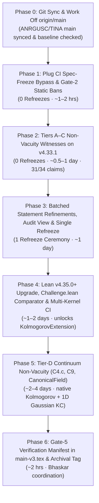

# arXiv v3 Lean Proof Hardening & Verification Plan

**Date:** 2026-11-26  
**Scope:** `papers/arxiv-v3/lean/` (`TinaV2`), `.github/workflows/verify-arxiv-v3-lean.yml`, `.github/scripts/pages_lean_record.py`, and Gate-5 disclosure in `submissions/arxiv-v3/main-v3.tex`  
**Inputs:**
- Comparative analysis of `P4` vs. TINA's Frozen-Spec SQLite Ledger (`tina-analysis.md`, 2026-11-26)
- Empirical Lean engineering-proof best practices (`best-practices.md`, from `survey-lean-proofs-eng-arxiv`: 12,613 preprints, 82 Lean papers, 7 `P4` adopters)
- Internal TINA audit ([proof-quality-evaluation-2026-11-22.md](../papers/arxiv-v3/lean/proof-quality-evaluation-2026-11-22.md)) and parked items ([future-tasks.md](../papers/arxiv-v3/lean/future-tasks.md))

---

## 1. Strategic Verdict

**Keep TINA's Frozen-Spec SQLite Ledger architecture (`P4` + `P3` step-mirroring) as the core—do not replace it with generic `P4`—and graft the missing `P4` Gate 1/2/3/5 checks onto it as additive layers.**

Across the 15-category arXiv survey, TINA already outperforms all 7 surveyed `P4` repositories on three dimensions where `P4` struggles in practice:
1. **Type (ii) step-level proof fidelity:** 162 step/main lemmas checked at the compiled `Lean.Environment` expression-DAG level (`auditUses` in `tools/ledger.py`), vs. `0/7` `P4` repos.
2. **Zero AI proof bloat (Mode #10):** 9,227 non-empty LoC across 34 claims (~271 LoC/claim), 8.8x more compact than the `P4` median (81,481 LoC; `5/7` bloated above 20k LoC).
3. **Auditable human governance & closed-loop paper repair:** 42 SHA-256 `frozen_files`, 87 typed `statement_deltas`, 21 `findings`, 61 completed `dispositions`, 12 upstream fixes in `arXiv v3`, and commit-matched GitHub Actions provenance (`verification.json` + 4-view Proof Explorer).

What remains to reach a complete 5-Gate `P4+` gold standard are **six targeted upgrades** closing specific gaps where surveyed `P4` repos or frontier standards currently beat TINA:

| Gap / Failure Mode | Current State in `TINA` | Target State | Phase |
| :--- | :--- | :--- | :---: |
| **Git branch / upstream sync** | Operating directly on `main` tracking `origin/main` (`ANRGUSC/TINA`) | Synced with `origin/main`, working cleanly off `main` (done) | **0** |
| **Live CI spec-freeze bypass (Mode #5/#7)** | `tools/verify_release.py` never calls `ledger.run_check(db)`; `verify-arxiv-v3-lean.yml` and `.github/scripts/pages_lean_record.py` ignore `submissions/arxiv-v3/*.tex`; no static ban on `unsafe`/`native_decide`/`elab`/`macro`; 6 benign `local notation` macros in `Proofs/` | `verify_release.py` enforces `ledger.run_check(db)`, Gate-2 static bans, and `.thmInfo` checks; TeX sources included in CI/reuse inputs; `0` notation overrides | **1** |
| **Zero compiled non-vacuity witnesses (Mode #4, Gate 1)** | `0` compiled `∃` instances across 34 universally quantified claims (Tiers A–C unblocked on `v4.33.1`; Tier D `CanonicalField.continuous` load-bearing for measurability) | Kernel-checked non-vacuity witnesses for Tiers A–C (31/34 claims) on `v4.33.1`, followed by Tier-D Gaussian/OU & continuous `CanonicalField` witnesses | **2 & 5** |
| **Residual `restricted` deltas & v2 headers (Mode #1, Gate 4)** | `C1`/`C1.c` unlinked from already-proved `Model.R_eq_sigmaRegret`; `C12` omits almost-sure uniqueness (`C12/f1/d3`); 27 frozen files still cite `main-v2.tex`; step-signature review view pending | Closed avoidable `restricted` deltas, v3 headers aligned, side-by-side step-signature review view & cross-LLM audit complete, **single** consolidated `--refreeze` | **3** |
| **Single-kernel monoculture & missing `comparator` boundary (Mode #8, Gate 3)** | Pinned to Lean `v4.33.1` single C++ kernel inside one Lake workspace; no external `Challenge.lean` export replay | Lean `v4.35.0+` + Mathlib upgrade (also unlocking native `KolmogorovExtension` `#44909`), auto-generated `Challenge.lean` + `lake comparator` + multi-kernel replay (`lake check --paranoid` / `nanoda`) in CI | **4** |
| **Manuscript invisibility & Scope-Note Erasure risk (Mode #2/#12, Gate 5)** | `submissions/arxiv-v3/main-v3.tex` has `0` Lean/Mathlib mentions (`has_lean_strong = False`) | Concise Gate-5 Verification Manifest in `main-v3.tex` disclosing `verified` (17) vs. `verified_supplied` (17), OU/field scope, numerics (`C21`–`C24`), Proof Explorer URL, kernels passed, and immutable git tag | **6** |

---

## 2. Recommended Execution Sequence

The sequence below is ordered to **eliminate live CI risk first, minimize `frozen_files` refreeze churn to exactly one ceremony, and leverage the Mathlib upgrade before tackling continuum non-vacuity**:



### Why This Exact Order Matters
1. **Phase 0 before any edits:** Ensures all hardening changes land cleanly on top of Bhaskar's latest `ANRGUSC/TINA` `main` (and avoids diverging `scott-arxiv2-lean` from `main`).
2. **Phase 1 before Phases 2–5:** Wiring `ledger.run_check(db)` and static policy bans into `verify_release.py` takes ~1–2 hours with **zero refreezes**, and immediately protects every subsequent phase against accidental spec mutation or TeX drift.
3. **Phase 2 before Phase 3/4:** Tiers A–C non-vacuity witnesses require **zero edits to frozen `Defs/`/`Statements/`** and **zero Mathlib upgrades**, certifying 31/34 claims immediately on `v4.33.1`.
4. **Phase 3 before Phase 4:** Batching `C1`/`C1.c` bridge export, `C12` uniqueness, and the 27 `main-v2.tex` header updates into **one refreeze** stabilizes all specs *before* generating `Challenge.lean` in Phase 4.
5. **Phase 4 before Phase 5:** Upgrading from `v4.33.1` to `v4.35.0+` simultaneously enables multi-kernel Gate-3 verification *and* brings Mathlib's native `KolmogorovExtension` (`#44909`), eliminating ~290 lines of manual backport debt for Phase 5.
6. **Phase 6 last:** The in-manuscript Gate-5 Verification Manifest cites final toolchain versions, `Challenge.lean` SHA-256, passed kernels, non-vacuity coverage, and the immutable release tag—so it is written once everything is verified.

---

## 3. Detailed Action List by Phase

### Phase 0: Git Sync & Working Off `origin/main` (Completed 2026-11-26)

**Actions:**
- [x] **0.1 Operate directly on `main` tracking `origin/main` (`https://github.com/ANRGUSC/TINA.git`):**
  - Fetched `origin/main` (`44d190a`) and switched from `scott-arxiv2-lean` to `main`.
  - Confirmed clean fast-forward history (`44d190a` -> `b66b3bd` -> `b96b7e3` -> this plan).
- [x] **0.2 Run baseline sanity check:**
  - `python3 papers/arxiv-v3/lean/tools/ledger.py check` — verified `0 errors, 0 warnings`.
- [ ] **0.3 Optional cleanup:** Delete the retired local `scott-arxiv2-lean` branch once no longer needed.

**Exit Criteria:** Clean `main` branch synced with `origin/main`, `ledger.py check` clean.

---

### Phase 1: Close CI Spec-Freeze Bypass & Gate-2 Static Policy Hardening (~1–2 hours · Zero Refreezes)

**Goal:** Make TINA's existing frozen-spec guarantees and Gate-2 static hygiene hard CI merge gates without touching any frozen `Defs/` or `Statements/` file.

**Actions:**
- [ ] **1.1 Enforce `ledger.run_check(db)` inside `papers/arxiv-v3/lean/tools/verify_release.py`:**
  - At the start of `verify()` (`verify_release.py:12-29`), call `errs, warns = ledger.run_check(db)`.
  - Raise `ValueError` immediately if `errs` is non-empty (blocking any un-refrozen `Defs/`/`Statements/` edit, broken verbatim TeX step, unmapped lemma, or import-isolation violation).
  - Include `check_warnings: warns` in the emitted `verification.json` and print a warning summary in `GITHUB_STEP_SUMMARY`.
- [ ] **1.2 Close the TeX-change CI & verification-reuse blind spot:**
  - In `.github/workflows/verify-arxiv-v3-lean.yml` (`pull_request.paths`), add:
    - `'submissions/arxiv-v3/main-v3.tex'`
    - `'submissions/arxiv-v3/technical-appendices-v3.tex'`
  - In `.github/scripts/pages_lean_record.py` (`INPUTS`, lines 15–17), add `'submissions/arxiv-v3/main-v3.tex'` and `'submissions/arxiv-v3/technical-appendices-v3.tex'` so `publish-reading-guide.yml` cannot reuse a prior `verification.json` when manuscript text changes.
- [ ] **1.3 Add Gate-2 comment-stripped static policy checks to `ledger.py check`:**
  - Add a Lean comment-stripping scanner (`--` line comments and nested `/- ... -/` block comments) checking all `.lean` files under `TinaV2/` (`Defs/`, `Statements/`, `Routine/`, `Proofs/`, `Assembly.lean`) for forbidden constructs:
    - Soundness / compiler-trust bypasses: `sorry`, `admit`, `axiom`, `native_decide`, `ofReduceBool`, `ofReduceNat`, `trustCompiler`, `unsafe`, `implemented_by`, `extern`.
    - Metaprogramming / notation overrides: `#eval`, `elab`, `macro`, `macro_rules`, `syntax`, `local notation`, `notation` (in `Proofs/`, `Statements/`, `Defs/`, `Routine/`).
  - Note: Keep `Smoke.lean` (or future `Challenge.lean` stubs in Phase 4) explicitly scoped so intentional `Challenge.lean` `sorry` stubs are isolated outside `TinaV2/`.
- [ ] **1.4 Strengthen `AUDIT_LEAN` in `papers/arxiv-v3/lean/tools/ledger.py` (lines 874–912):**
  - For every `TinaV2.Assembly.Cxx` theorem, assert `env.find? n` matches `.thmInfo` (`wasOriginallyTheorem`, preventing `def`/non-theorem spoofing).
  - Explicitly check that `Lean.ofReduceBool` and `Lean.trustCompiler` never appear in transitive axioms (already implied by `<= STANDARD_AXIOMS`, but worth explicit error diagnostics).
- [ ] **1.5 Eliminate all 6 `local notation` macros in `TinaV2/Proofs/`:**
  - Replace with plain `let`/`abbrev` or `Routine/` helpers in:
    - `TinaV2/Proofs/C09/A1.lean:30`
    - `TinaV2/Proofs/C16/A1.lean:18`, `20`
    - `TinaV2/Proofs/C17b/A1.lean:26`
    - `TinaV2/Proofs/C18/A1.lean:30`
    - `TinaV2/Proofs/C19/A1.lean:15` (superseded attempt; clean anyway so repo-wide static scans report `0` notation overrides)
- [ ] **1.6 Deduplicate derivative-sign monotonicity helper (`future-tasks.md:83-85`):**
  - Merge the duplicate wrapper between `TinaV2/Routine/ExpRadius.lean` and `TinaV2/Routine/RadiusCalculus.lean`.

**Exit Criteria:**
- `python3 tools/ledger.py check` passes with `0 errors, 0 warnings` and `0` static red-flag hits (including `0` `local notation`).
- Local dry run of `verify_release.py` (or targeted unit test) confirms it fails immediately when a frozen file or verbatim TeX step is perturbed.
- `lake build TinaV2` and `python3 tools/ledger.py audit` pass cleanly.

---

### Phase 2: Tiers A–C Non-Vacuity Witnesses on `v4.33.1` (~0.5–1 day · Zero Refreezes)

**Goal:** Eliminate `Mode #4` (vacuous-truth risk) for **31 of 34 proved claims** immediately on `v4.33.1`, touching zero frozen `Defs/` or `Statements/` files.

**Design Decision (Confirm Before Coding):**
- **Recommended layout:** Create `TinaV2/NonVacuity/FiniteModels.lean` (imported by `TinaV2.lean`, kept separate from `Proofs/` so the ledger's 1:1 manuscript-claim mapping stays pure) and add a `NonVacuity` axiom-audit list to `verify_release.py` / `AUDIT_LEAN` so every non-vacuity witness is CI-verified to use only `{propext, Classical.choice, Quot.sound}`.
- *Alternative:* Track non-vacuity witnesses as formalizations in the SQLite ledger. (Higher ledger schema overhead for objects that are not paper claims.)

**Actions:**
- [ ] **2.1 Analytic curves witness (`C15`, `C15.b`, `C15.c`, `C16`):**
  - Instantiate `SmoothCurves η τ D` on `[0, 1]` with $\eta(r) = \frac{1}{2} e^{-2r}$, $\tau(r) = r$, $T = 4$.
  - Prove `StrictAntiOn (balanceGap η τ T D) (Icc 0 D)`.
  - Exhibit both an **interior crossing** witness and a **boundary-sticking** witness (where increasing $T$ leaves the optimum pinned at $0$ or $D$, directly resolving parked item `C15.c/f1/d3` in `future-tasks.md:89-91`).
- [ ] **2.2 Aggregate-coupling witness (`C12`, `C13`, `C13.b`, `C13.c`):**
  - Instantiate `n = 2`, $q = 1$, $\gamma = 1$, $\sigma = 1$ with independent Rademacher states $\theta_1, \theta_2 \in \{-1, +1\}$ under uniform probability measure on `Bool × Bool`.
  - Prove `Q.PosDef`, `IsAggregateModel`, and `AggregateState`.
- [ ] **2.3 Finite team, crossover, & projection witnesses (`C1`–`C3.b`, `C5`, `C5.b`, `C6.b`, `C6.c`, `C7`, `C7.b`, `C8`, `C8.c`, `C10`, `C10.b`, `C11`, `C14`):**
  - On the same 2-agent Rademacher space (`ι = κ = α = Fin 2` over `Bool × Bool`), prove `0 < M.Rinf` and `0 < M.etaS μ 0 < 1` (`η₀ = 1/2`, matching the two-sensor example `C11`) and instantiate the `C1`–`C3` Hilbert projection hypothesis bundle.
  - Instantiate a non-degenerate `TemporalAssumption` witness (e.g., at zero delay / discrete stationary coupling, with the continuous-time Gaussian OU witness following in Phase 5).
- [ ] **2.4 Wire `NonVacuity` theorems into `verify_release.py`:**
  - Verify `lake build TinaV2` compiles `TinaV2.NonVacuity.FiniteModels` and record its theorems' transitive axioms (`{propext, Classical.choice, Quot.sound}`) in `verification.json`.

**Exit Criteria:** All non-continuum hypothesis bundles (31/34 claims) have kernel-checked `∃ ...` existential witnesses in `TinaV2/NonVacuity/FiniteModels.lean` audited by CI with standard axioms only.

---

### Phase 3: Batched Statement Polish, Co-Author Audit View & Single Consolidated Refreeze (~1 day · 1 Refreeze Ceremony)

**Goal:** Close every avoidable Layer-A `restricted` delta, update stale `v2` file headers, add the planned human review view, run an independent cross-LLM semantic check, and perform **exactly one** `ledger.py freeze --refreeze` pass.

**Actions:**
- [ ] **3.1 Export / link the Doob–Dynkin bridge (`C1/f1/d5`, `C1.c/f1/d1`):**
  - `Model.R_eq_sigmaRegret` is already proved in `TinaV2/Routine/RadiusInfo.lean:91-112`.
  - Add a concise bridge statement (either as a conjunct/corollary on `C1`/`C1.c` or a dedicated frozen bridge declaration exported in `Assembly.lean`) and update `statement_deltas` to clear the two "not yet linked to the function-form regret of the main text" `restricted` deltas.
- [ ] **3.2 Close almost-sure uniqueness gap in headline `C12` (`C12/f1/d3`):**
  - Strengthen `TinaV2/Statements/C12.lean` (or add sub-claim `C12.b`) to assert that $u_i = \theta_i / (q + \gamma)$ is **almost-surely unique** among admissible local rules attaining `R_loc`, derived cleanly from `C2` + `Model.R_eq_sigmaRegret` (~10–20 lines).
  - Optionally decide whether to add the analogous uniqueness clause to `C11` (`C11/f1/d2`, `future-tasks.md:92-94`).
- [ ] **3.3 Triage parked unused-hypothesis items (`future-tasks.md` §1b):**
  - **Recommendation:** Keep hypotheses that mirror the paper's stated assumptions (`SmoothCurves`, `0 < v`, `0 < T`, `IsProbabilityMeasure`) so statements stay faithful to the manuscript; drop only purely formalization-internal unused hypotheses (`C5.b`: `Measurable snap`, `MemLp snap 2`, `Measurable now`) if Scott agrees.
- [ ] **3.4 Align all 27 frozen file headers from `v2` to `v3`:**
  - Update header comments across the 27 files in `TinaV2/Defs/` and `TinaV2/Statements/` that still reference `main-v2.tex` / `technical-appendices-v2.tex` to cite `main-v3.tex` / `technical-appendices-v3.tex` with exact v3 line numbers.
- [ ] **3.5 Build the side-by-side Step-Signature Audit View & routine-disposition transparency (`README.md:314-319`):**
  - Add a compact review view in `papers/arxiv-v3/lean/progress/` pairing each `(Step TeX ↔ Lean Step Lemma Signature + statement_deltas)` for rapid human sign-off.
  - Surface the 20 routine-level `lean_ref` dispositions (`supplement.md`) in the Proof Explorer claim view/legend so readers clearly see what `Routine/` discharges beneath `verified` claims.
- [ ] **3.6 Independent cross-LLM semantic audit (Gate 4, Role Separation):**
  - Run an adversarial back-translation check (using a distinct model family from the proving agent, e.g., Gemini or GPT) across all 8 `Defs/` + 34 `Statements/` files against `submissions/arxiv-v3/main-v3.tex` and `technical-appendices-v3.tex` to flag any subtle quantifier, boundary, or hypothesis inversion before freezing.
- [ ] **3.7 Consolidated Refreeze Ceremony:**
  - Review unified diff across `Defs/`, `Statements/`, and `statement_deltas` with Scott.
  - Run `ledger.py freeze ... --refreeze` once for modified frozen files, regenerate `Assembly.lean` + docs (`ledger.py assembly && ledger.py docs`), and verify `ledger.py check` + `lake build TinaV2` + `ledger.py audit`.

**Exit Criteria:** Avoidable `restricted` deltas (`C1`, `C1.c`, `C12`) closed; 0 `main-v2.tex` header leftovers; side-by-side step-signature audit view live; single clean refreeze commit green in CI.

---

### Phase 4: Toolchain Upgrade (`v4.35.0+`), Auto-Generated `Challenge.lean` Comparator & Multi-Kernel Gate 3 (~1–2 days)

**Goal:** Add `P4`'s cryptographic adversarial boundary (`lake comparator`), eliminate single-kernel C++ monoculture (`Mode #8`), and unlock native Mathlib `KolmogorovExtension` (`#44909`) for Phase 5.

**Actions:**
- [ ] **4.1 Bump Lean & Mathlib pin from `v4.33.1` to `v4.35.0+`:**
  - Select the latest stable Lean/Mathlib release tag (`>= v4.35.0`) that (a) includes Mathlib `#44909` (`MeasureTheory/Constructions/KolmogorovExtension.lean`), (b) has prebuilt Mathlib oleans on `lake exe cache`, and (c) is supported by `lake comparator` and multi-kernel checking (`lake check --paranoid` / `nanoda`).
  - Update `papers/arxiv-v3/lean/lean-toolchain` and `papers/arxiv-v3/lean/lakefile.toml` (`rev`).
  - Fix any Mathlib API renames across the 28 imported modules in `TinaV2/Prelude.lean` and `TinaV2/` (record proof-file adjustments as Lean-only retries; if any `Defs/`/`Statements/` syntax shift is unavoidable, document it explicitly in the refreeze note).
- [ ] **4.2 Auto-generate `Challenge.lean`, `Solution.lean`, and `comparator.json`:**
  - Extend `tools/ledger.py assembly` (or add `ledger.py comparator-spec`) to emit a deterministic standalone `Challenge.lean` importing **only** `TinaV2.Defs` and `TinaV2.Statements` with `theorem Cxx : TinaV2.Cxx.Statement := by sorry` stubs (plus a `Solution.lean` re-exporting `TinaV2.Assembly`), and record the SHA-256 of `Challenge.lean`.
  - Keep `Challenge.lean` outside `TinaV2/` (e.g., `comparator/Challenge.lean`) so the Phase-1 zero-`sorry` scan on `TinaV2/` remains strictly unconditional.
- [ ] **4.3 Wire `lake comparator` + multi-kernel verification into `verify_release.py` and CI:**
  - Run `lake comparator` (verifying exported proof terms from `Solution.lean` against hash-locked `Challenge.lean`) inside `tools/verify_release.py`.
  - Run `lake check --paranoid` (or explicit external kernel replay via `nanoda` / `lean4lean` / `con-leche`, depending on available release binaries for the target Lean version) inside `.github/workflows/verify-arxiv-v3-lean.yml`.
  - Record `challenge_sha256`, `comparator_passed`, and `kernels_passed` in `verification.json` and display them in the Proof Explorer verification badge.

**Exit Criteria:** Clean-checkout GitHub Actions CI passes `lake build TinaV2`, `ledger.py check`, `ledger.py audit`, `lake comparator`, and independent multi-kernel replay, with `challenge_sha256` and `kernels_passed` published in `verification.json`.

---

### Phase 5: Tier-D Continuum Non-Vacuity (`C4.c`, `C9`, and `CanonicalField`) (~2–4 days)

**Goal:** Prove in Lean (using only standard axioms) that a non-trivial stationary Ornstein–Uhlenbeck Gaussian process (`C4.c`, `C9`) and a pathwise spatially continuous space-time `CanonicalField` (`C17`–`C19`) with $\sigma \neq 0$ actually exist—closing the single deepest mathematical non-vacuity question (`CanonicalField.continuous` in `Defs/Canonical.lean:46`).

**Actions:**
- [ ] **5.1 Step 5a — Stationary Gaussian / OU process witnesses (`C4.c` & `C9`, ~150–250 LoC):**
  - Create `TinaV2/NonVacuity/GaussianModels.lean`.
  - Build on Phase 4's native Mathlib `KolmogorovExtension` (`#44909`) and `Matrix.PosSemidef.hadamard` (leveraging the 2026-11-19 scratch results in `b66b3bd`: pre-Brownian motion on `ℝ≥0 → ℝ`, time-changed $X_t = e^{-t/T} B(e^{2t/T})$ with covariance $e^{-|t-s|/T}$, and general PSD-kernel Gaussian process construction via `measurePreserving_restrict₂_multivariateGaussian`).
  - Prove positive-semidefiniteness of the 1D exponential kernel $e^{-|t-s|/T}$ cleanly via explicit ordered-grid AR(1)/Markov innovation decomposition.
  - Instantiate concrete witnesses for `C4.c` and `C9` with `0 < M.Rinf`.
- [ ] **5.2 Step 5b — Specialized 1D Gaussian Kolmogorov–Chentsov for `CanonicalField` (~350–500 LoC):**
  - Avoid vendoring 190 KB of general metric-space KC from `RemyDegenne/brownian-motion`.
  - Exploit two TINA-specific simplifications:
    1. `CanonicalField.continuous` only requires spatial continuity $z \mapsto \theta(z, t, \omega)$ at each fixed $t$, and the covariance $\sigma^2 e^{-|z-z'|/\ell_s} e^{-|t-s|/T}$ is a separable product of two 1D OU kernels.
    2. For centered 1D Gaussian increments with $\mathbb{E}[(X_z - X_{z'})^2] \le L |z - z'|$, Gaussian fourth moments immediately satisfy $\mathbb{E}[(X_z - X_{z'})^4] = 3(\mathbb{E}[(X_z - X_{z'})^2])^2 \le 3 L^2 |z - z'|^2$ (exponent $1 + \beta = 2 > 1$).
  - Construct a Borel–Cantelli dyadic-grid continuous modification on $[-N, N]$ (patched over $N \in \mathbb{N}$), preserving `IsGaussianProcess`, zero mean, measurability, and exact `cov`.
  - Prove:
    ```lean
    theorem exists_canonicalField (hσ : σ ≠ 0) (hℓs : 0 < ℓs) (hT : 0 < T) :
      ∃ (Ω : Type) (_ : MeasurableSpace Ω) (μ : Measure Ω) (_ : IsProbabilityMeasure μ)
        (θ : ℝ → ℝ → Ω → ℝ), CanonicalField μ θ σ ℓs T
    ```
- [ ] **5.3 Audit Tier-D witnesses in `verify_release.py`:**
  - Add `GaussianModels` / `exists_canonicalField` to the CI axiom audit list (`{propext, Classical.choice, Quot.sound}` only) and surface non-vacuity coverage (`34/34 claims`) in `verification.json` and the Proof Explorer.

**Exit Criteria:** `exists_canonicalField` and `C4.c`/`C9` witnesses compile cleanly in CI with standard axioms only, achieving **34/34** non-vacuity coverage across Tiers A–D.

---

### Phase 6: Gate-5 Manuscript Verification Manifest & Immutable Archival Release (~2 hours)

**Goal:** Eliminate TINA's arXiv full-text invisibility (`has_lean_strong = False`) and prevent `Mode #2` (Scope-Note Erasure) by documenting the exact formalization scope, boundaries, and provenance directly inside `submissions/arxiv-v3/main-v3.tex`.

**Actions:**
- [ ] **6.1 Draft Gate-5 Verification Manifest for `submissions/arxiv-v3/main-v3.tex` (coordinate with Bhaskar):**
  - Add a 1-sentence pointer in the Abstract or Introduction noting machine-checked Lean 4 verification.
  - Add a concise `\paragraph{Formal Verification.}` block adjacent to `\paragraph{Code and Data Availability.}` (`main-v3.tex:1309-1319`) containing:
    - **Headline count:** All **34 mathematical claims** (10/10 numbered theorems, propositions, lemmas, and corollaries + 24 remarks/examples; 162 step-audited lemmas) verified in **Lean 4** + **Mathlib** (`0 sorry`, `{propext, Classical.choice, Quot.sound}` only).
    - **Explicit verification tiers & scope boundaries:**
      - `verified` (17 claims, 9/10 headline): 1:1 sentence-mirrored directly from the manuscript text.
      - `verified_supplied` (17 claims, 1/10 headline `C18`): statement frozen and proved unconditionally, with omitted steps/proofs written out explicitly in `papers/arxiv-v3/lean/supplement.md`.
      - **Modeling boundaries:** Ornstein–Uhlenbeck remarks (`C4.c`, `C9`) formalize the stationary Gaussian covariance law rather than the Itô SDE `eq:OU_process`; `CanonicalField` (`C17`–`C19`) uses a pathwise spatially continuous version (backed by a compiled non-vacuity witness); numerical figures (`C21`–`C24`) are verified by deterministic Python scripts rather than Lean.
    - **Provenance links:** Public Proof Explorer (`https://anrgusc.github.io/TINA/arxiv-v3/proofs/`), immutable git tag (`arxiv-v3-lean-v1.0`), Lean toolchain version, Mathlib commit SHA, `Challenge.lean` SHA-256, and kernels passed (`lean`, `comparator`, `nanoda` / `--paranoid`).
- [ ] **6.2 Re-verify manuscript alignment & rebuild PDF:**
  - Verify `ledger.py check` passes (`0 errors, 0 warnings`) against the updated `main-v3.tex` (update `sources` SHA-256/commit in the ledger and refresh `progress/paper-passages.json` if pagination shifts).
  - Run clean CI (`verify-arxiv-v3-lean.yml` + `publish-reading-guide.yml`).
- [ ] **6.3 Cut immutable archival release tag:**
  - Tag `arxiv-v3-lean-v1.0` on `ANRGUSC/TINA` `main` (and sync to Scott's fork) and update `CITATION.cff` / `references.bib` software citation if applicable.

**Exit Criteria:** `main-v3.tex` passes Gate-5 disclosure (`has_lean_strong = True`, explicit scope boundaries), CI & GitHub Pages Proof Explorer publish commit-matched multi-kernel `verification.json`, and `arxiv-v3-lean-v1.0` is tagged.

---

## 4. Open Decisions Needed Before Starting

| # | Decision | Impacted Phase | Recommendation |
| :---: | :--- | :---: | :--- |
| **D1** | **Non-vacuity module placement:** Standalone `TinaV2/NonVacuity/*.lean` audited by `verify_release.py`, or new rows inside `ledger/data.sql`? | Phases 2 & 5 | **Standalone `TinaV2/NonVacuity/`** audited by `verify_release.py` (keeps the ledger's `claims` table strictly 1:1 with the manuscript). |
| **D2** | **Scope of `C1`/`C1.c` bridge & `C12` uniqueness:** Strengthen existing `C1`/`C1.c`/`C12` statements in place, or add sub-claims (`C12.b`)? | Phase 3 | Add `R_eq_sigmaRegret` bridge + `C12` uniqueness in Phase 3's single consolidated refreeze; keep paper-mirroring hypotheses in `future-tasks.md` §1b. |
| **D3** | **Target Lean/Mathlib version for Gate 3:** Pin to `v4.35.0` or latest stable Mathlib release with `#44909` + working `comparator` + `nanoda`? | Phase 4 | Verify binary/cache availability of `comparator` + `nanoda`/`lake check --paranoid` right before Phase 4 and pin to the newest stable tag supporting all three. |
| **D4** | **Co-author sign-off on `main-v3.tex` Gate-5 block:** Include a 1-sentence abstract mention, or keep disclosure in Introduction + Code/Data Availability? | Phase 6 | Coordinate with Bhaskar: 1 sentence in Intro (or Abstract) + structured `\paragraph{Formal Verification.}` beside Code and Data Availability. |

---

## 5. Explicitly Deferred / Out of Scope for This Plan

The following items from `tina-analysis.md` and `future-tasks.md` are valuable long-term follow-ups, but should **not** block `arxiv-v3-lean-v1.0`:
1. **Extracting the TINA Frozen-Spec Ledger + Auto-Generated `Challenge.lean`/`comparator` harness as a paper-agnostic open-source template repo** (high strategic value for future ANRG papers, best spun out *after* Phases 1–4 stabilize the tooling here).
2. **Deriving the Ornstein–Uhlenbeck covariance law from the Itô SDE `eq:OU_process`** (`C4.c/f1/d1`, `future-tasks.md:107-114`) and **generalizing `C4.c` to nonzero mean** (`C4.c/f1/d2`) or **`C9` to non-Gaussian modes** (`future-tasks.md:101-106`).
3. **Suggesting paper-side hypothesis weakenings to Bhaskar** (`future-tasks.md` §1a) — cosmetic/reader-facing choices with no soundness impact.
