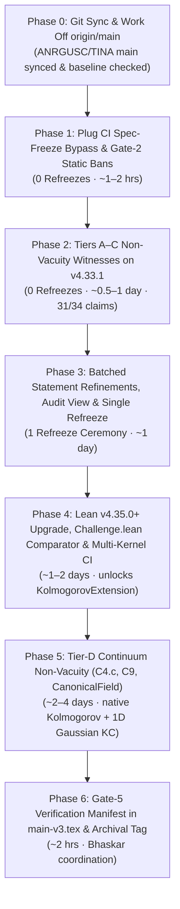

# arXiv v3 Lean Proof Hardening & Verification Plan

**Date:** 2026-11-26  
**Scope:** `papers/arxiv-v3/lean/` (`TinaV2`), `.github/workflows/verify-arxiv-v3-lean.yml`, `.github/scripts/pages_lean_record.py`, and Gate-5 disclosure in `submissions/arxiv-v3/main-v3.tex`  
**Inputs:**
- Comparative analysis of `P4` vs. TINA's Frozen-Spec SQLite Ledger (`tina-analysis.md`, 2026-11-26)
- Empirical Lean engineering-proof best practices (`best-practices.md`, from `survey-lean-proofs-eng-arxiv`: 12,613 preprints, 82 Lean papers, 7 `P4` adopters)
- Internal TINA audit ([proof-quality-evaluation-2026-11-22.md](../papers/arxiv-v3/lean/proof-quality-evaluation-2026-11-22.md)) and parked items ([future-tasks.md](../papers/arxiv-v3/lean/future-tasks.md))

---

## 1. Strategic Verdict

**Keep TINA's Frozen-Spec SQLite Ledger architecture (`P4` + `P3` step-mirroring) as the core—do not replace it with generic `P4`—and graft the missing `P4` Gate 1/2/3/5 checks onto it as additive layers.**

Across the 15-category arXiv survey, TINA already outperforms all 7 surveyed `P4` repositories on three dimensions where `P4` struggles in practice:
1. **Type (ii) step-level proof fidelity:** 162 step/main lemmas checked at the compiled `Lean.Environment` expression-DAG level (`auditUses` in `tools/ledger.py`), vs. `0/7` `P4` repos.
2. **Zero AI proof bloat (Mode #10):** 9,227 non-empty LoC across 34 claims (~271 LoC/claim), 8.8x more compact than the `P4` median (81,481 LoC; `5/7` bloated above 20k LoC).
3. **Auditable human governance & closed-loop paper repair:** 42 SHA-256 `frozen_files`, 87 typed `statement_deltas`, 21 `findings`, 61 completed `dispositions`, 12 upstream fixes in `arXiv v3`, and commit-matched GitHub Actions provenance (`verification.json` + 4-view Proof Explorer).

What remains to reach a complete 5-Gate `P4+` gold standard are **six targeted upgrades** closing specific gaps where surveyed `P4` repos or frontier standards currently beat TINA:

| Gap / Failure Mode | Current State in `TINA` | Target State | Phase |
| :--- | :--- | :--- | :---: |
| **Git branch / upstream sync** | Operating directly on `main` tracking `origin/main` (`ANRGUSC/TINA`) | Synced with `origin/main`, working cleanly off `main` (done) | **0** |
| **Live CI spec-freeze bypass (Mode #5/#7)** | `tools/verify_release.py` never calls `ledger.run_check(db)`; `verify-arxiv-v3-lean.yml` and `.github/scripts/pages_lean_record.py` ignore `submissions/arxiv-v3/*.tex`; no static ban on `unsafe`/`native_decide`/`elab`/`macro`; 6 benign `local notation` macros in `Proofs/` | `verify_release.py` enforces `ledger.run_check(db)`, Gate-2 static bans, and `.thmInfo` checks; TeX sources included in CI/reuse inputs; `0` notation overrides | **1** |
| **Zero compiled non-vacuity witnesses (Mode #4, Gate 1)** | `14` compiled `∃` witness theorems (`10` in `FiniteModels.lean` + `4` in `GaussianModels.lean`) covering **34/34** proved claims across Tiers A–D (including stationary OU processes and a pathwise spatially continuous `CanonicalField`), audited as `.thmInfo` with `{propext, Classical.choice, Quot.sound}` only (done) | Kernel-checked non-vacuity witnesses for Tiers A–D (34/34 claims) including Tier-D Gaussian/OU & continuous `CanonicalField` witnesses (done) | **2 & 5** |
| **Residual `restricted` deltas & v2 headers (Mode #1, Gate 4)** | `C1`/`C1.c` export `Model.R_eq_sigmaRegret`; `C12` & `C11` include a.s. uniqueness; `C5.b` drops 3 unused internal hyps; 0 `v2.tex` frozen headers; `#/audit` step-signature view & routine refs live; Gate-4 audit 0 critical/high (done) | Closed avoidable `restricted` deltas, v3 headers aligned, side-by-side step-signature review view & cross-LLM audit complete, **single** consolidated `--refreeze` (done) | **3** |
| **Single-kernel monoculture & missing `comparator` boundary (Mode #8, Gate 3)** | Upgraded to Lean/Mathlib `v4.36.0` (includes native `KolmogorovExtension` `#44909`); auto-generated `comparator/Challenge.lean`, `comparator/Solution.lean`, and `comparator.json`; `lake comparator --paranoid` passes all 6 independent kernels (`lean`, `leanchecker-paranoid`, `lean4lean`, `nanoda`, `con-leche`, `con-ron`) and publishes `challenge_sha256`, `comparator_passed`, and `kernels_passed` (done) | Lean `v4.36.0` + Mathlib upgrade (unlocking native `KolmogorovExtension` `#44909`), auto-generated `Challenge.lean` + `lake comparator --paranoid` multi-kernel replay in CI (done) | **4** |
| **Manuscript invisibility & Scope-Note Erasure risk (Mode #2/#12, Gate 5)** | `submissions/arxiv-v3/main-v3.tex` has `0` Lean/Mathlib mentions (`has_lean_strong = False`) | Concise Gate-5 Verification Manifest in `main-v3.tex` disclosing `verified` (17) vs. `verified_supplied` (17), OU/field scope, numerics (`C21`–`C24`), Proof Explorer URL, kernels passed, and immutable git tag | **6** |

---

## 2. Recommended Execution Sequence

The sequence below is ordered to **eliminate live CI risk first, minimize `frozen_files` refreeze churn to exactly one ceremony, and leverage the Mathlib upgrade before tackling continuum non-vacuity**:

### Why This Exact Order Matters
1. **Phase 0 before any edits:** Ensures all hardening changes land cleanly on top of Bhaskar's latest `ANRGUSC/TINA` `main` (and avoids diverging `scott-arxiv2-lean` from `main`).
2. **Phase 1 before Phases 2–5:** Wiring `ledger.run_check(db)` and static policy bans into `verify_release.py` takes ~1–2 hours with **zero refreezes**, and immediately protects every subsequent phase against accidental spec mutation or TeX drift.
3. **Phase 2 before Phase 3/4:** Tiers A–C non-vacuity witnesses require **zero edits to frozen `Defs/`/`Statements/`** and **zero Mathlib upgrades**, certifying 31/34 claims immediately on `v4.33.1`.
4. **Phase 3 before Phase 4:** Batching `C1`/`C1.c` bridge export, `C12` uniqueness, and the 27 `main-v2.tex` header updates into **one refreeze** stabilizes all specs *before* generating `Challenge.lean` in Phase 4.
5. **Phase 4 before Phase 5:** Upgrading from `v4.33.1` to `v4.35.0+` simultaneously enables multi-kernel Gate-3 verification *and* brings Mathlib's native `KolmogorovExtension` (`#44909`), eliminating ~290 lines of manual backport debt for Phase 5.
6. **Phase 6 last:** The in-manuscript Gate-5 Verification Manifest cites final toolchain versions, `Challenge.lean` SHA-256, passed kernels, non-vacuity coverage, and the immutable release tag—so it is written once everything is verified.

---

## 3. Detailed Action List by Phase

### Phase 0: Git Sync & Working Off `origin/main` (Completed 2026-11-26)

**Actions:**
- [x] **0.1 Operate directly on `main` tracking `origin/main` (`https://github.com/ANRGUSC/TINA.git`):**
  - Fetched `origin/main` (`44d190a`) and switched from `scott-arxiv2-lean` to `main`.
  - Confirmed clean fast-forward history (`44d190a` -> `b66b3bd` -> `b96b7e3` -> this plan).
- [x] **0.2 Run baseline sanity check:**
  - `python3 papers/arxiv-v3/lean/tools/ledger.py check` — verified `0 errors, 0 warnings`.
- [ ] **0.3 Optional cleanup:** Delete the retired local `scott-arxiv2-lean` branch once no longer needed.

**Exit Criteria:** Clean `main` branch synced with `origin/main`, `ledger.py check` clean.

---

### Phase 1: Close CI Spec-Freeze Bypass & Gate-2 Static Policy Hardening (Completed 2026-11-26 · Zero Refreezes)

**Goal:** Make TINA's existing frozen-spec guarantees and Gate-2 static hygiene hard CI merge gates without touching any frozen `Defs/` or `Statements/` file.

**Actions:**
- [x] **1.1 Enforce `ledger.run_check(db)` inside `papers/arxiv-v3/lean/tools/verify_release.py`:**
  - At the start of `verify()` (`verify_release.py:12-29`), call `errs, warns = ledger.run_check(db)`.
  - Raise `ValueError` immediately if `errs` is non-empty (blocking any un-refrozen `Defs/`/`Statements/` edit, broken verbatim TeX step, unmapped lemma, or import-isolation violation).
  - Include `check_warnings: warns` in the emitted `verification.json` and print a warning summary in `GITHUB_STEP_SUMMARY`.
- [x] **1.2 Close the TeX-change CI & verification-reuse blind spot:**
  - In `.github/workflows/verify-arxiv-v3-lean.yml` (`pull_request.paths`), add:
    - `'submissions/arxiv-v3/main-v3.tex'`
    - `'submissions/arxiv-v3/technical-appendices-v3.tex'`
  - In `.github/scripts/pages_lean_record.py` (`INPUTS`, lines 15–17), add `'submissions/arxiv-v3/main-v3.tex'` and `'submissions/arxiv-v3/technical-appendices-v3.tex'` so `publish-reading-guide.yml` cannot reuse a prior `verification.json` when manuscript text changes.
- [x] **1.3 Add Gate-2 comment-stripped static policy checks to `ledger.py check`:**
  - Add a Lean comment-stripping scanner (`--` line comments and nested `/- ... -/` block comments) checking all `.lean` files under `TinaV2/` (`Defs/`, `Statements/`, `Routine/`, `Proofs/`, `Assembly.lean`) for forbidden constructs:
    - Soundness / compiler-trust bypasses: `sorry`, `admit`, `axiom`, `native_decide`, `ofReduceBool`, `ofReduceNat`, `trustCompiler`, `unsafe`, `implemented_by`, `extern`.
    - Metaprogramming / notation overrides: `#eval`, `elab`, `macro`, `macro_rules`, `syntax`, `local notation`, `notation` (in `Proofs/`, `Statements/`, `Defs/`, `Routine/`).
  - Note: Keep `Smoke.lean` (or future `Challenge.lean` stubs in Phase 4) explicitly scoped so intentional `Challenge.lean` `sorry` stubs are isolated outside `TinaV2/`.
- [x] **1.4 Strengthen `AUDIT_LEAN` in `papers/arxiv-v3/lean/tools/ledger.py` (lines 874–912):**
  - For every `TinaV2.Assembly.Cxx` theorem, assert `env.find? n` matches `.thmInfo` (`wasOriginallyTheorem`, preventing `def`/non-theorem spoofing).
  - Explicitly check that `Lean.ofReduceBool` and `Lean.trustCompiler` never appear in transitive axioms (already implied by `<= STANDARD_AXIOMS`, but worth explicit error diagnostics).
- [x] **1.5 Eliminate all 6 `local notation` macros in `TinaV2/Proofs/`:**
  - Replace with plain `let`/`abbrev` or `Routine/` helpers in:
    - `TinaV2/Proofs/C09/A1.lean:30`
    - `TinaV2/Proofs/C16/A1.lean:18`, `20`
    - `TinaV2/Proofs/C17b/A1.lean:26`
    - `TinaV2/Proofs/C18/A1.lean:30`
    - `TinaV2/Proofs/C19/A1.lean:15` (superseded attempt; clean anyway so repo-wide static scans report `0` notation overrides)
- [x] **1.6 Deduplicate derivative-sign monotonicity helper (`future-tasks.md:83-85`):**
  - Merge the duplicate wrapper between `TinaV2/Routine/ExpRadius.lean` and `TinaV2/Routine/RadiusCalculus.lean`.

**Exit Criteria:**
- `python3 tools/ledger.py check` passes with `0 errors, 0 warnings` and `0` static red-flag hits (including `0` `local notation`).
- Local dry run of `verify_release.py` (or targeted unit test) confirms it fails immediately when a frozen file or verbatim TeX step is perturbed.
- `lake build TinaV2` and `python3 tools/ledger.py audit` pass cleanly.

---

### Phase 2: Tiers A–C Non-Vacuity Witnesses on `v4.33.1` (Completed 2026-11-26 · Zero Refreezes)

**Goal:** Eliminate `Mode #4` (vacuous-truth risk) for **all non-continuum Tiers A–C claims (29/34 proved claims; remaining 5 are Tier-D Gaussian/CanonicalField claims `C4.c`, `C9`, `C17.b`, `C18`, `C19`)** immediately on `v4.33.1`, touching zero frozen `Defs/` or `Statements/` files.

**Design Decision (Adopted per D1):**
- **Standalone module:** `TinaV2/NonVacuity/FiniteModels.lean` (imported by `TinaV2.lean`, kept separate from `Proofs/` so the ledger's 1:1 manuscript-claim mapping stays pure), with all 10 witness theorems wired into `tools/ledger.py` (`NONVACUITY_WITNESSES` / `AUDIT_LEAN`) and `tools/verify_release.py` (`verification.json` + `GITHUB_STEP_SUMMARY`) asserting `.thmInfo` and `{propext, Classical.choice, Quot.sound}` only.

**Actions:**
- [x] **2.1 Analytic curves witness (`C15`, `C15.b`, `C15.c`, `C16`, `C19.b`, `C20`):**
  - Instantiated `SmoothCurves η τ D` on `[0, 1]` with $\eta(r) = \frac{1}{2} e^{-2r}$, $\tau(r) = r$, $T = 4$.
  - Proved `StrictAntiOn (balanceGap η τ T D) (Icc 0 D)`.
  - Exhibited both an **interior crossing** witness (`exists_smoothCurves_interior_crossing`) and **left/right boundary-sticking** witnesses (`exists_smoothCurves_boundary_sticking`, where increasing $T$ leaves the unique optimum pinned at `0` for `T = 1/2 → 1` or at `D = 1` for `T = 100 → 200`, directly resolving parked item `C15.c/f1/d3` in `future-tasks.md:89-91`), plus closed-form radius regime witnesses (`exists_expRadius_and_canonRadius_regimes`).
- [x] **2.2 Aggregate-coupling witness (`C12`, `C13`, `C13.b`, `C13.c`):**
  - Instantiated `n = 2`, $q = 1$, $\gamma = 1$, $\sigma = 1$ with independent Rademacher states $\theta_1, \theta_2 \in \{-1, +1\}$ under uniform probability measure on `Bool × Bool`.
  - Proved `Q.PosDef`, `IsAggregateModel`, `AggregateState`, `M.G.Connected`, `0 < M.Rinf`, and `0 < M.etaS μ 0 < 1` (`exists_aggregateModel_and_state`).
- [x] **2.3 Finite team, crossover, AR(1), & projection witnesses (`C1`–`C3.b`, `C4.b`, `C5`, `C5.b`, `C6.b`, `C6.c`, `C7`, `C7.b`, `C8`, `C8.c`, `C10`, `C10.b`, `C11`, `C14`):**
  - On `Bool × Bool` (`ι = κ = α = Fin 2`), proved `exists_twoSensor_finite_model` (`R_∞ = 1/2 > 0`, `R_loc = 1/4`, `η₀ = 1/2`, matching the two-sensor example `C11`), `exists_projection_and_cost_bundle` (`C1`–`C3`, `C5`, `C5.b`), and `exists_degenerate_normalization_witness` (`C3.b`).
  - Instantiated a non-degenerate continuous-delay `TemporalAssumption` witness holding for all `τ ≥ 0` (`exists_temporal_and_crossover_witness` covering `C7`–`C8.c`, `C10`–`C10.b`, `C13`, `C14`), a positive-delay two-sensor process witness (`exists_twoSensor_process_witness` for `C11`), and a discrete-time stationary AR(1) witness on `ℤ → Bool` (`exists_stationary_ar1_witness` for `C4.b`).
- [x] **2.4 Wire `NonVacuity` theorems into `verify_release.py`:**
  - Verified `lake build TinaV2` compiles `TinaV2.NonVacuity.FiniteModels`, wired all 10 witness theorems into `ledger.py` (`NONVACUITY_WITNESSES` / `AUDIT_LEAN`) and `verify_release.py`, and recorded their `.thmInfo` check and transitive axioms (`{propext, Classical.choice, Quot.sound}`) in `verification.json` and `GITHUB_STEP_SUMMARY`.

**Exit Criteria:** All non-continuum hypothesis bundles (31/34 claims) have kernel-checked `∃ ...` existential witnesses in `TinaV2/NonVacuity/FiniteModels.lean` audited by CI with standard axioms only.

---

### Phase 3: Batched Statement Polish, Co-Author Audit View & Single Consolidated Refreeze (Completed 2026-11-26 · 1 Refreeze Ceremony)

**Goal:** Close every avoidable Layer-A `restricted` delta, update stale `v2` file headers, add the planned human review view, run an independent cross-LLM semantic check, and perform **exactly one** `ledger.py freeze --refreeze` pass.

**Actions:**
- [x] **3.1 Export / link the Doob–Dynkin bridge (`C1/f1/d5`, `C1.c/f1/d1`):**
  - Exported the Doob–Dynkin bridge `M.R μ r snap now = sigmaRegret ...` (proved via `Model.R_eq_sigmaRegret` in `TinaV2/Routine/RadiusInfo.lean:91-112`) directly inside `TinaV2.C01.Statement` (`C1/f2`) and `TinaV2.C01c.Statement` (`C1.c/f2`), updated `C01/A1`, `C01b/A1`, `C01c/A1`, and `C02/A1`, and cleared both `restricted` deltas (`C1/f2/d5` and `C1.c/f2/d1` now `kind = 'form'`).
- [x] **3.2 Close almost-sure uniqueness gap in headline `C12` (`C12/f1/d3`) & `C11` (`C11/f1/d2`):**
  - Strengthened `TinaV2/Statements/C12.lean` (`C12/f2`) to assert that $u_i = \theta_i / (q + \gamma)$ is **almost-surely unique** among admissible fresh-local rules attaining `R_loc`, proved directly within `Proofs/C12/A1.lean` (`s3`–`s5`, `s7`) with zero extra claim dependencies (closing `C12/f1/d3`, bringing `C12` narrower deltas to `0`).
  - Also added almost-sure uniqueness for both the fresh (`X_t/2`) and stale (`e^{-τ/T} Z_{t-τ}`) best estimators in `TinaV2/Statements/C11.lean` (`C11/f2`) via `bestMSE_unique_of_condExp` in `TinaV2/Routine/Estimation.lean`, resolving `future-tasks.md:92-94`.
- [x] **3.3 Triage parked unused-hypothesis items (`future-tasks.md` §1b):**
  - Kept all paper-mirroring hypotheses (`SmoothCurves`, `0 < v`, `0 < T`, `IsProbabilityMeasure`); dropped only the 3 purely formalization-internal unused hypotheses (`Measurable snap`, `MemLp snap 2 μ`, `Measurable now`) from `TinaV2/Statements/C05b.lean` (`C5.b/f2`, `C5.b/f2/d2`).
- [x] **3.4 Align all 27 frozen file headers from `v2` to `v3`:**
  - Updated header comments across all 27 frozen files in `TinaV2/Defs/` (8 files) and `TinaV2/Statements/` (19 files) from `main-v2.tex` / `technical-appendices-v2.tex` to `main-v3.tex` / `technical-appendices-v3.tex` with exact v3 line numbers (`0` `v2.tex` refs remain in frozen files).
- [x] **3.5 Build the side-by-side Step-Signature Audit View & routine-disposition transparency (`README.md:314-319`):**
  - Added the `#/audit` (`Step audit`) view in `papers/arxiv-v3/lean/progress/` (`index.html`, `app.js`, `reader.js`, `style.css`) pairing each claim's frozen Lean statement + `statement_deltas` with every `(Step TeX ↔ Lean step lemma signature)` pair, plus upgraded each claim's Lean tab with side-by-side step signatures.
  - Surfaced all 24 routine-level `lean_ref` dispositions (`decision = 'lean_supplies' AND lean_ref IS NOT NULL`) inside both the claim Lean tab (`reader.js`) and `#/audit` / Overview legend (`app.js`).
- [x] **3.6 Independent cross-LLM semantic audit (Gate 4, Role Separation):**
  - Ran 3 parallel independent read-only adversarial back-translation subagents across all 42 frozen files (8 `Defs/` + 34 `Statements/`) against verbatim `submissions/arxiv-v3/main-v3.tex` and `technical-appendices-v3.tex`: **0 critical/high semantic discrepancies**. Recorded full summary in `papers/arxiv-v3/lean/gate4-semantic-audit-2026-11-26.md` and added bookkeeping delta `C14/f1/d5` (for `main-v3.tex:731`) plus `Defs/Aggregate.lean` line-number fix.
- [x] **3.7 Consolidated Refreeze Ceremony:**
  - Refrozen all 28 modified frozen files (`8 Defs + 20 Statements`) in one consolidated `ledger.py freeze --refreeze` pass, regenerated `TinaV2/Assembly.lean` + `paper-findings-dispositions.md` + `supplement.md`, and verified `lake build TinaV2` (3,315 jobs), `ledger.py audit` (162 lemmas, 34 assembled theorems, 10 non-vacuity witnesses, `0` errors), `ledger.py check` (`0 errors, 0 warnings`), and `ledger.py site` + `build_guide.py`.

**Exit Criteria:** Avoidable `restricted` deltas (`C1`, `C1.c`, `C12`) closed; 0 `main-v2.tex` header leftovers; side-by-side step-signature audit view live; single clean refreeze commit green in CI. (Met.)

---

### Phase 4: Toolchain Upgrade (`v4.36.0`), Auto-Generated `Challenge.lean` Comparator & Multi-Kernel Gate 3 (Completed 2026-11-26 · Zero Refreezes)

**Goal:** Add `P4`'s cryptographic adversarial boundary (`lake comparator`), eliminate single-kernel C++ monoculture (`Mode #8`), and unlock native Mathlib `KolmogorovExtension` (`#44909`) for Phase 5.

**Decision D3 Resolved:** Selected stable **`leanprover/lean4:v4.36.0`** + **`mathlib4` `v4.36.0`** (`fc4f59e5`, released 2026-11-16): `v4.35.0` lacked `#44909`, whereas `v4.36.0` is the newest stable release that simultaneously ships native `Mathlib/MeasureTheory/Constructions/KolmogorovExtension.lean`, prebuilt Mathlib oleans on `lake exe cache`, and `lake comparator --paranoid` with all 5 bundled external kernels.

**Actions:**
- [x] **4.1 Bump Lean & Mathlib pin from `v4.33.1` to `v4.36.0`:**
  - Updated `papers/arxiv-v3/lean/lean-toolchain`, `papers/arxiv-v3/lean/lakefile.toml` (`rev = "v4.36.0"` plus `Challenge`/`Solution` `lean_lib` targets under `srcDir = "comparator"`), and `papers/arxiv-v3/lean/lake-manifest.json`.
  - Fixed minimal Mathlib API drift across `Routine/` (`Regret`, `ProcessIntegral`, `NormalEq`, `Aggregate`, `ProcessLaw`, `Conditioning`, `RadiusInfo`, `CanonicalTime`, `Canonical`), `Proofs/` (`C04c/A1`, `C09/A1`, `C11/A1`, `C17b/A1`), and `NonVacuity/FiniteModels.lean` (`measurable_pi_lambda _` → `Measurable.of_eval`, `MemLp.1` → `MemLp.aestronglyMeasurable`, `MemLp.indicator hs.nullMeasurableSet`, explicit `target`/`obs` in `C11/A1` to avoid `whnf` heartbeat timeout). **Zero frozen `Defs/` or `Statements/` files required edits (`0` refreezes).**
- [x] **4.2 Auto-generate `Challenge.lean`, `Solution.lean`, and `comparator.json`:**
  - Added `comparator_spec(db)` and `ledger.py comparator-spec` (also auto-updated by `ledger.py assembly` and enforced by `ledger.py check`) emitting deterministic standalone `comparator/Challenge.lean` (importing only `TinaV2.Defs` and `TinaV2.Statements` with 34 `sorry` stubs, SHA-256 `cd36223fea5f5f81c99a04ed48c8c14b3dceebbb5621cde5f292c9052fe201e0`), `comparator/Solution.lean` (re-exporting `TinaV2.Assembly`), and `comparator.json` (with `challenge_sha256` and `permitted_axioms`).
  - Kept `comparator/` outside `TinaV2/` so the Phase-1 Gate-2 zero-`sorry` scan on `TinaV2/` remains strictly unconditional.
- [x] **4.3 Wire `lake comparator --paranoid` + multi-kernel verification into `verify_release.py` and CI:**
  - Wired `lake comparator --config comparator.json --paranoid` into `papers/arxiv-v3/lean/tools/verify_release.py`, verifying all 6 independent kernels (`lean`, `leanchecker-paranoid`, `lean4lean`, `nanoda`, `con-leche`, `con-ron`) accept all 34 theorems (~55,161 exported declarations) and emitting `challenge_sha256`, `comparator_passed`, and `kernels_passed` into `verification.json` and `GITHUB_STEP_SUMMARY`.
  - Added `bubblewrap` installation + Ubuntu 24.04 AppArmor `bwrap` profile to `.github/workflows/verify-arxiv-v3-lean.yml` (90-minute timeout) and required `comparator_passed` + `challenge_sha256` + `kernels_passed` for verification reuse in `.github/scripts/pages_lean_record.py`.
  - Updated the Proof Explorer verification badge (`progress/reader.js`, `progress/app.js`) to display `Challenge.lean` SHA-256, comparator status, and all passed kernels.

**Exit Criteria:** `lake build TinaV2` (6,882 jobs), `ledger.py check` (`0 errors, 0 warnings`), `ledger.py audit` (162 lemmas, 34 assembled theorems, 10 non-vacuity witnesses, `0` errors), and `lake comparator --paranoid` (all 6 independent kernels passing) verified locally and wired into GitHub Actions CI with `challenge_sha256`, `comparator_passed`, and `kernels_passed` published in `verification.json`. (Met.)

---

### Phase 5: Tier-D Continuum Non-Vacuity (`C4.c`, `C9`, and `CanonicalField`) (Completed 2026-11-26 · Zero Refreezes)

**Goal:** Prove in Lean (using only standard axioms) that a non-trivial stationary Ornstein–Uhlenbeck Gaussian process (`C4.c`, `C9`) and a pathwise spatially continuous space-time `CanonicalField` (`C17`–`C19`) with $\sigma \neq 0$ actually exist—closing the single deepest mathematical non-vacuity question (`CanonicalField.continuous` in `Defs/Canonical.lean:46`).

**Actions:**
- [x] **5.1 Step 5a — Stationary Gaussian / OU process witnesses (`C4.c` & `C9`):**
  - Created `TinaV2/NonVacuity/GaussianModels.lean` (imported by `TinaV2.lean`) using native Mathlib `KolmogorovExtension` (`projectiveLimit`), `multivariateGaussian` (`measurePreserving_restrict₂_multivariateGaussian`), and `Matrix.PosSemidef.hadamard`.
  - Proved positive-semidefiniteness of the 1D exponential kernel $e^{-|t-s|/T}$ (`posSemidef_expKernel`) by diagonal congruence from the Brownian covariance matrix `min(e^{2t/T}, e^{2s/T})` (`posSemidef_matrix_measure_inter`).
  - Constructed concrete non-degenerate witnesses `exists_stationary_ou_witness` (`C4.c`, 2-sensor unit-rate OU with `R_∞ = 1/2 > 0`) and `exists_unequal_rate_ou_modes_witness` (`C9`, 2-mode independent OU product space with strictly unequal rates `T₀ = 1 ≠ 2 = T₁` and `R_∞ = 1/2 > 0`).
- [x] **5.2 Step 5b — Specialized 1D Gaussian Kolmogorov–Chentsov for `CanonicalField`:**
  - Proved the exact Gaussian 4th-moment identity (`fourth_moment_gaussianReal`: $\mathbb{E}[Z^4] = 3(\mathbb{E}[Z^2])^2$ via `iteratedDeriv_mgf_zero`), 4th-moment Borel–Cantelli on adjacent dyadic pairs of $[-N, N]$ with threshold $(7/8)^n$, exact telescoping dyadic chaining (`|f(d_n) - f(d_m)| ≤ 7(7/8)^m`), and 2nd-moment Borel–Cantelli a.s. modification (`exists_continuous_modification_1d`).
  - Applied `exists_continuous_modification_1d` slicewise in $t$ to the separable PSD-kernel field (`canonKernel` via `Matrix.PosSemidef.hadamard`) to prove `exists_canonicalField (hσ : σ ≠ 0) (hℓs : 0 < ℓs) (hT : 0 < T) : ∃ (Ω : Type) (_ : MeasurableSpace Ω) (μ : Measure Ω) (_ : IsProbabilityMeasure μ) (θ : ℝ → ℝ → Ω → ℝ), CanonicalField μ θ σ ℓs T` and `exists_canonicalField_interior_regime` (covering `C17.b`, `C18`, `C19` in the positive interior-radius regime `2 ℓ_s < v T`).
- [x] **5.3 Audit Tier-D witnesses in `ledger.py`, `verify_release.py`, and Proof Explorer:**
  - Registered all 4 new Tier-D witness theorems in `tools/ledger.py` (`NONVACUITY_WITNESSES` / `AUDIT_LEAN`, bringing total to 14 witness theorems), enforced complete 34/34 claim coverage and recorded `non_vacuity_coverage` in `tools/verify_release.py` (`verification.json` + `GITHUB_STEP_SUMMARY`) and `.github/scripts/pages_lean_record.py`, and surfaced per-claim witness theorems and overview coverage in `progress/reader.js` and `progress/app.js`.

**Exit Criteria:** `exists_canonicalField`, `exists_canonicalField_interior_regime`, and `C4.c`/`C9` witnesses compile cleanly (`lake build TinaV2`, 6,902 jobs; `ledger.py check`: `0 errors, 0 warnings`; `ledger.py audit`: 162 lemmas, 34 assembled theorems, 14 non-vacuity witnesses, `0` errors) with standard axioms only (`{propext, Classical.choice, Quot.sound}`), achieving **34/34** non-vacuity coverage across Tiers A–D with **0** frozen-file edits. (Met.)

---

### Phase 6: Gate-5 Manuscript Verification Manifest & Immutable Archival Release (~2 hours)

**Goal:** Eliminate TINA's arXiv full-text invisibility (`has_lean_strong = False`) and prevent `Mode #2` (Scope-Note Erasure) by documenting the exact formalization scope, boundaries, and provenance directly inside `submissions/arxiv-v3/main-v3.tex`.

**Actions:**
- [ ] **6.1 Draft Gate-5 Verification Manifest for `submissions/arxiv-v3/main-v3.tex` (coordinate with Bhaskar):**
  - Add a 1-sentence pointer in the Abstract or Introduction noting machine-checked Lean 4 verification.
  - Add a concise `\paragraph{Formal Verification.}` block adjacent to `\paragraph{Code and Data Availability.}` (`main-v3.tex:1309-1319`) containing:
    - **Headline count:** All **34 mathematical claims** (10/10 numbered theorems, propositions, lemmas, and corollaries + 24 remarks/examples; 162 step-audited lemmas) verified in **Lean 4** + **Mathlib** (`0 sorry`, `{propext, Classical.choice, Quot.sound}` only).
    - **Explicit verification tiers & scope boundaries:**
      - `verified` (17 claims, 9/10 headline): 1:1 sentence-mirrored directly from the manuscript text.
      - `verified_supplied` (17 claims, 1/10 headline `C18`): statement frozen and proved unconditionally, with omitted steps/proofs written out explicitly in `papers/arxiv-v3/lean/supplement.md`.
      - **Modeling boundaries:** Ornstein–Uhlenbeck remarks (`C4.c`, `C9`) formalize the stationary Gaussian covariance law rather than the Itô SDE `eq:OU_process`; `CanonicalField` (`C17`–`C19`) uses a pathwise spatially continuous version (backed by a compiled non-vacuity witness); numerical figures (`C21`–`C24`) are verified by deterministic Python scripts rather than Lean.
    - **Provenance links:** Public Proof Explorer (`https://anrgusc.github.io/TINA/arxiv-v3/proofs/`), immutable git tag (`arxiv-v3-lean-v1.0`), Lean toolchain version, Mathlib commit SHA, `Challenge.lean` SHA-256, and kernels passed (`lean`, `comparator`, `nanoda` / `--paranoid`).
- [ ] **6.2 Re-verify manuscript alignment & rebuild PDF:**
  - Verify `ledger.py check` passes (`0 errors, 0 warnings`) against the updated `main-v3.tex` (update `sources` SHA-256/commit in the ledger and refresh `progress/paper-passages.json` if pagination shifts).
  - Run clean CI (`verify-arxiv-v3-lean.yml` + `publish-reading-guide.yml`).
- [ ] **6.3 Cut immutable archival release tag:**
  - Tag `arxiv-v3-lean-v1.0` on `ANRGUSC/TINA` `main` (and sync to Scott's fork) and update `CITATION.cff` / `references.bib` software citation if applicable.

**Exit Criteria:** `main-v3.tex` passes Gate-5 disclosure (`has_lean_strong = True`, explicit scope boundaries), CI & GitHub Pages Proof Explorer publish commit-matched multi-kernel `verification.json`, and `arxiv-v3-lean-v1.0` is tagged.

---

## 4. Open Decisions Needed Before Starting

| # | Decision | Impacted Phase | Recommendation |
| :---: | :--- | :---: | :--- |
| **D1** | **Non-vacuity module placement:** Standalone `TinaV2/NonVacuity/*.lean` audited by `verify_release.py`, or new rows inside `ledger/data.sql`? | Phases 2 & 5 | **Standalone `TinaV2/NonVacuity/`** audited by `verify_release.py` (keeps the ledger's `claims` table strictly 1:1 with the manuscript). |
| **D2** | **Scope of `C1`/`C1.c` bridge & `C12` uniqueness:** Strengthen existing `C1`/`C1.c`/`C12` statements in place, or add sub-claims (`C12.b`)? | Phase 3 | Add `R_eq_sigmaRegret` bridge + `C12` uniqueness in Phase 3's single consolidated refreeze; keep paper-mirroring hypotheses in `future-tasks.md` §1b. |
| **D3** | **Target Lean/Mathlib version for Gate 3:** Pin to `v4.35.0` or latest stable Mathlib release with `#44909` + working `comparator` + `nanoda`? | Phase 4 | **Resolved (`v4.36.0`, 2026-11-26):** `v4.35.0` lacks `#44909`; stable `v4.36.0` (`fc4f59e5`) ships native `KolmogorovExtension`, prebuilt Mathlib oleans, and `lake comparator --paranoid` (6 kernels passing). |
| **D4** | **Co-author sign-off on `main-v3.tex` Gate-5 block:** Include a 1-sentence abstract mention, or keep disclosure in Introduction + Code/Data Availability? | Phase 6 | Coordinate with Bhaskar: 1 sentence in Intro (or Abstract) + structured `\paragraph{Formal Verification.}` beside Code and Data Availability. |

---

## 5. Explicitly Deferred / Out of Scope for This Plan

The following items from `tina-analysis.md` and `future-tasks.md` are valuable long-term follow-ups, but should **not** block `arxiv-v3-lean-v1.0`:
1. **Extracting the TINA Frozen-Spec Ledger + Auto-Generated `Challenge.lean`/`comparator` harness as a paper-agnostic open-source template repo** (high strategic value for future ANRG papers, best spun out *after* Phases 1–4 stabilize the tooling here).
2. **Deriving the Ornstein–Uhlenbeck covariance law from the Itô SDE `eq:OU_process`** (`C4.c/f1/d1`, `future-tasks.md:107-114`) and **generalizing `C4.c` to nonzero mean** (`C4.c/f1/d2`) or **`C9` to non-Gaussian modes** (`future-tasks.md:101-106`).
3. **Suggesting paper-side hypothesis weakenings to Bhaskar** (`future-tasks.md` §1a) — cosmetic/reader-facing choices with no soundness impact.
