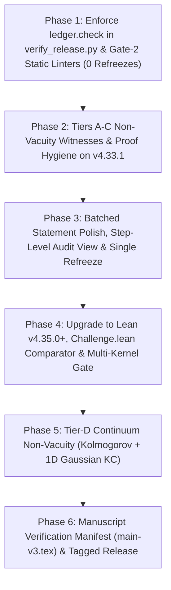

# Evaluation of the TINA arXiv-v3 Lean Formalization Against 2026 Engineering Preprints and Frontier Verification Standards

- **Date:** 2026-11-22
- **Target evaluated:** `papers/arxiv-v3/lean/` (`TinaV2`, rebased onto `origin/main` at `44d190a` + `b66b3bd`, aligned to `submissions/arxiv-v3/` at `12a9b32`)
- **Reference benchmarks:**
  1. **Frontier Verification Taxonomy (`proof-methods.md`):** 12 documented AI-Lean failure modes across Layers A–C, 4 Lean↔LaTeX authoring paradigms (`P1`–`P4`), Role Separation, and the 5-Gate Production Pipeline.
  2. **Empirical arXiv Engineering Survey (`survey-lean-proofs-eng-arxiv`):** Full-text screening of **3,160** arXiv preprints (Nov 1–19, 2026) across `cs.DC`, `cs.NI`, `cs.IT`, `eess.SY`, `cs.CR`, and `cs.RO`, identifying **20 confirmed Lean-contributing papers** (11 `engineering_math_proof`), with deep Layer-A adversarial audits across all **8 locally cloned `engineering_math_proof` repositories**.

---

## 1. Executive Summary

Evaluated against both the 2026 frontier taxonomy (`proof-methods.md`) and the 20 Lean-backed engineering preprints uncovered in the November 2026 arXiv survey, **TINA's `papers/arxiv-v3/lean` formalization ranks at the very top of the engineering cohort in semantic fidelity, proof intelligibility, CI provenance, and bidirectional manuscript governance—and is the single strongest exemplar of Bastounis et al. Type (ii) step-faithful formalization across all inspected repositories.**

Where 80% (16/20) of surveyed arXiv Lean papers rely on post-hoc `P1` formalization, **0 of 13** cloned paper repositories ship GitHub Actions `lake build` CI, and 8/13 suffer severe AI proof bloat (**29,967–929,448 non-empty LoC**), TINA verifies **34 mathematical claims** (all 10 advertised theorems, propositions, lemmas, and corollaries plus 24 remarks/examples, totaling **162 audited step/main lemmas**) in **9,227 non-empty LoC** across 104 files (~271 LoC per verified claim; ~5.2 s average file build time), with **zero `sorry`, zero custom `axiom`s, zero `native_decide`, and zero `unsafe` declarations**. Even more distinctively:
- TINA's SQLite ledger (`ledger/schema.sql`, `ledger/data.sql`, `tools/ledger.py`) enforces **sentence-level 1:1 proof mirroring** verified at the compiled `Expr` level (`ledger.py audit`)—a property achieved by **0 of the 20 surveyed arXiv papers**—and already drove **12 substantive upstream fixes** in `arXiv v3` (`284a0e0`, `12a9b32`).
- With the newly landed upstream release infrastructure (`4dca3d4`..`44d190a`), TINA is now **the only paper repository across the entire cohort** with automated GitHub Actions clean-checkout `lake build` + transitive axiom auditing (`verify-arxiv-v3-lean.yml`, `tools/verify_release.py`) publishing commit-matched `verification.json` records directly into a four-view public [Proof Explorer](https://anrgusc.github.io/TINA/arxiv-v3/proofs/) (proof sketch, PDF-cropped manuscript passages, Lamport proof, and Lean source).

At the same time, our audit against `proof-methods.md` and peer `Tier3_Gold` repositories (`ExplicitRIPTwoThirds`, `MatrixRefresh`, `bp-response-geometry-lean`, `d3-lean-verification`) surfaces **five concrete gaps** to close for full five-gate certification:

1. **Manuscript Invisibility & Gate-5 Provenance Gap in `submissions/arxiv-v3/` (High — Mode #2/#12):** Running the exact `survey-lean-proofs-eng-arxiv` Stage-2 full-text scanner on `submissions/arxiv-v3/main-v3.tex` and `technical-appendices-v3.tex` returns **zero Lean hits** (`has_lean_strong = False`, `has_lean_contextual = False`). While the web guide (`/arxiv-v3/`) showcases the proofs, the LaTeX manuscript itself never mentions Lean 4, Mathlib, the Proof Explorer URL, or a Gate-5 Verification Manifest scoping `verified` (17), `verified_supplied` (17), law-modeled Ornstein–Uhlenbeck (`C4.c`/`C9`), and `numeric` figure scripts (`C21`–`C24`).
2. **Zero Compiled Non-Vacuity Witnesses (High — Mode #4 / Gate 1):** All 34 proved statements are universally quantified implications (`∀ M μ θ ..., Hypotheses → Conclusion`) with **0 compiled non-vacuity instances** (`non_vacuity_example = 0`), compared with 3/8 audited engineering repos that prove concrete existential witnesses. Crucially, while Tier D (`CanonicalField`) requires a 1D Kolmogorov–Chentsov path-continuity construction, **Tiers A–C (31 of 34 claims) have no Mathlib blocker** and can be proved non-vacuous immediately on `v4.33.1`.
3. **CI Invariant Bypass in `verify_release.py` & Gate-2 Static Policy Hardening (High — Modes #5–#7):** Inspection of `tools/verify_release.py` (`60db9f7`) reveals a live enforcement gap: **`verify_release.py` checks `assembly_plan`, runs `lake build TinaV2`, and runs `ledger.audit_selected`, but never calls `ledger.run_check(db)`!** Consequently, modifying a frozen `Defs/`/`Statements/` file without `--refreeze`, drifting from verbatim TeX steps, or adding unmapped helper lemmas in `Proofs/` would still pass `verify_release.py` and emit a green `verification.json` artifact (surfacing only as a soft JSON warning in `ledger.py site`). In addition, neither `check` nor `verify_release.py` statically bans `native_decide`/`ofReduceBool`/`trustCompiler`, `unsafe`, `implemented_by`, `#eval`, or notation overrides (`Proofs/` currently has 6 benign file-scoped `local notation` macros), nor asserts `.thmInfo` (`wasOriginallyTheorem`) on `Assembly.*`.
4. **Pre-`v4.35.0` Single-Kernel Monoculture & Missing `comparator` Boundary (Medium–High — Mode #8 / Gate 3):** TINA is pinned to Lean `v4.33.1` (single C++ kernel) without a standalone `Challenge.lean`/`Solution.lean` `lake comparator` sandbox or Lean `v4.35.0+` `lake check --paranoid` multi-kernel replay (`nanoda`, `lean4lean`, `con-leche`). Upgrading to `v4.35.0+` / current Mathlib simultaneously unlocks multi-kernel verification *and* native `KolmogorovExtension` (`#44909`) for Tier-D non-vacuity.
5. **Residual Statement Refinements, Unlinked Doob–Dynkin Bridge & `verified` Badge Nuance (Low–Medium — Layer A / Gate 4):** Headline claims `C1` and `C1.c` remain marked `restricted` ("not yet linked to the function-form regret of the main text") even though the Doob–Dynkin equivalence `Model.R_eq_sigmaRegret` is already proved in `Routine/RadiusInfo.lean:91`; headline `C12` proves optimality of $\theta_i/(q+\gamma)$ without stating almost-sure uniqueness (`C12/f1/d3`); the step-level `(TeX Step ↔ Lean Step Lemma + statement_deltas)` co-author review view (`README.md:314-319`) and 27 `main-v2.tex` frozen file headers remain to be finalized; and 20 proof-level gaps (`supplement.md:397-422`) are discharged in `Routine/` while parent claims retain the pure `verified` badge.

Section 6 provides a **sequenced 6-phase improvement plan** engineered to close all five gaps with minimal refreeze churn.

---

## 2. Quantitative & Paradigm Comparison Against the Surveyed arXiv Cohort

### 2.1 Domain Context
In the 3,160-paper November 2026 pilot across ANRG-aligned categories (`cs.DC`, `cs.NI`, `cs.IT`, `eess.SY`, `cs.CR`, `cs.RO`), only **20 papers (0.63%)** contributed Lean proofs: 6 in `cs.DC`, 6 in `cs.IT`, 7 in `cs.CR`, 3 in `eess.SY`, and **0 in `cs.NI` (0/196)** or `cs.RO` (0/1,159). TINA—bridging networked systems (`cs.NI`), decentralized team control (`eess.SY`), and age of information (`cs.IT`)—sits in an engineering-theory niche with virtually zero prior Lean formalizations.

### 2.2 Static & Structural Metrics (Exact Survey Scanner)

Running `survey-lean-proofs-eng-arxiv/src/patterns.py` (`scan_lean_source` with comment stripping) on `papers/arxiv-v3/lean` enables an exact comparison with all 8 locally cloned `engineering_math_proof` repositories from Phase 2:

| Paper / Repo | Domain | Paradigm | Non-Empty LoC | `.lean` Files | Thms / Defs | `sorry` / Custom Ax / `native_decide` | CI (`lake build`) | Non-Vacuity Witnesses | Step-Level Proof Sync |
| :--- | :--- | :---: | ---: | ---: | ---: | :---: | :---: | :---: | :---: |
| **TINA (`TinaV2`)** | **`eess.SY` / `cs.NI` / `cs.IT`** | **`P3`/`P4` Hybrid** | **9,227** | **104** | **445 / 104** | **0 / 0 / 0** | **Yes (`verify_release.py`)** | **No (0)** | **Yes (162 lemmas, `Expr`-audited)** |
| `2611.18220` (`Lean-SysID`) | `eess.SY` | `P1` | 528 | 4 | 21 / 19 | 0 / 0 / 0 | No | No | Anchor snippets only |
| `2611.23762` (`CoprimeFrobenius`) | `quant-ph` / `cs.IT` | `P1` | 589 | 1 | 36 / 5 | 0 / 0 / 0 | No | No | Prose comments |
| `2611.10902` (`bic-public`) | `eess.SY` | `P1` | 2,068 | 11 | 102 / 40 | 0 / 0 / 0 | No | No† | Manual docstrings |
| `2611.14475` (`ExplicitRIPTwoThirds`) | `math.FA` / `cs.IT` | `P4` (`comparator`) | 29,967 | 379 | 1,222 / 258 | 4‡ / 0 / 0 | No | No† | Statement-only (`PAPER_MAP.md`) |
| `2611.11713` (`bp-response-geometry`) | `cs.IT` | `P1` | 69,875 | 257 | 3,955 / 1,291 | 0 / 0 / 0 | No | **Yes** | Statement-only (divergent routes) |
| `2611.04876` (`MatrixRefresh`) | `cs.CR` | `P4` (`comparator`) | 81,481 | 417 | 3,285 / 1,933 | 41‡ / 0 / 0 | No | **Yes** | Statement-only |
| `2611.08172` (`d3-lean-verification`) | `cs.IT` | `P1` | 200,335 | 2,486 | 8,473 / 5,031 | 0 / 0 / 0 | No | **Yes** | Statement-only |
| `2611.05136` (`aft-lean-theorem99`) | `cs.CC` / `cs.CR` | `P1` | 219,688 | 1,794 | 11,051 / 6,431 | 0 / 0 / 0 | No | No | Explicitly disclaimed |

*\†`bic-public` instantiates Table I utility families; `ExplicitRIPTwoThirds` constructs concrete prime families in `main_theorem`, but neither includes standalone witnesses for universally quantified barrier/optimality theorems.*  
*\‡Intentional specification stubs in `Challenge.lean` / `ReferenceClaims` checked by `comparator`.*

### 2.3 Internal Codebase Architecture of `TinaV2`

| Component | Files | Non-Empty LoC | Raw Lines | `theorem`/`lemma` | `def`/`structure`/`abbrev` | Role & Architectural Discipline |
| :--- | ---: | ---: | ---: | ---: | ---: | :--- |
| `TinaV2/Prelude.lean` | 1 | 31 | 33 | 0 | 0 | Narrow 28-module Mathlib import list (~5.2 s avg file check vs ~48 s for `import Mathlib`; targeted `lake exe cache get` in CI) |
| `TinaV2/Defs/` (+ `Defs.lean`) | 9 | 383 | 503 | 0 | 55 | Shared mathematical model; reviewed file-by-file and SHA-256 frozen |
| `TinaV2/Statements/` (+ `Statements.lean`) | 35 | 693 | 903 | 0 | 35 | Pure `def Statement : Prop` specs (zero `sorry` stubs needed); all 34 live files SHA-256 frozen |
| `TinaV2/Routine/` | 20 | 3,008 | 3,528 | 243 | 14 | Implicit regularity, Hilbert $L^2_Q$ glue, Doob–Dynkin, Fubini, Gaussian conditioning; forbidden from importing `Statements/` or `Proofs/` |
| `TinaV2/Proofs/` | 36 | 4,943 | 5,339 | 167 | 0 | 34 selected attempts (5,224 raw lines) + 2 retained superseded attempts (`C08/A1`, `C19/A1`); strict 1:1 `step_map` + `main` |
| `TinaV2/Assembly.lean` + `Smoke.lean` + root | 3 | 169 | 214 | 35 | 0 | End-to-end unconditional composition of all 34 verified claims + `#print axioms` |
| **Total** | **104** | **9,227** | **10,519** | **445** | **104** | **Zero `sorry`, zero custom axioms, zero `native_decide`** |

### 2.4 Authoring Paradigm Placement (`P1`–`P4`)

In the `proof-methods.md` paradigm matrix:
- **0 / 20** surveyed arXiv papers achieved **`P3` (Spec-Pinned Synchronized Co-Development)** via `LeanArchitect` or `Verso`.
- **2 / 20** achieved **`P4` (Spec-Lock $\rightarrow$ AI-Solve)** via `comparator.json`.
- **TINA implements a custom `P3` + `P4` synthesis that outperforms standard `LeanArchitect` on proof-body fidelity:**
  - *Stronger than `P1`:* Rather than post-hoc compilation that silently mutates hypotheses when a proof step fails (the OpenAI Navier–Stokes Lemma 8.6 / 10.5 failure mode), TINA halted on every mismatch, logged 21 structured `findings` (`F1`–`F21`) and 57 `dispositions`, froze statements behind `v_freeze_blockers`, and fed 12 statement/proof repairs directly back into `submissions/arxiv-v3/`.
  - *Stronger than `P2` (Raw Lean-First):* Avoids the "Alien Proof & Bloat Trap" (`proof-methods.md` §3, Paradigm 2): the human manuscript retains natural team-theoretic prose while low-level measure-theoretic plumbing (`MemLp`, `StronglyMeasurable`, `ae_integrable`, `QFibre`) is cleanly quarantined inside `TinaV2/Routine/`.
  - *Cleaner LaTeX separation than `LeanArchitect` (`P3`):* Instead of invasive LaTeX macros (`\inputleannode`, `@[blueprint]`) inside `main-v3.tex`, TINA uses out-of-band SQLite verbatim substring locks (`ledger.py check` Rule 1), PDF passage coordinates (`progress/paper-passages.json`), and compiled `Expr` dependency auditing (`ledger.py audit`).
  - *One step short of full `P4` (`comparator`):* TINA pins `Defs/` and `Statements/` hashes in `frozen_files` and enforces role separation (Bhaskar as manuscript co-author, Scott as spec reviewer/freezer, Claude as prover, external ChatGPT pass as referee), but currently verifies proofs inside a single Lake workspace and single Lean `v4.33.1` kernel rather than replaying exported proof terms through `lake comparator` and independent kernels (`nanoda`, `lean4lean`, `con-leche`).

---

## 3. Audit Against the 12 Failure Modes of `proof-methods.md`

| Mode | Failure Mode (`proof-methods.md` §1) | TINA Rating | Evidence & Comparison to Surveyed Repos |
| :---: | :--- | :---: | :--- |
| **#1** | **NL↔Lean Proof & Statement Drift (Type I vs. Type II)** | **Exemplary (`min-d`)** | **Best in class.** Only project among all 21 (20 surveyed + TINA) that mechanically enforces **Type (ii) step-by-step correspondence** (`85` verbatim paper steps + `26` explicitly labeled supplied steps, checked against compiled `Expr` constants by `ledger.py audit`). All 87 live `statement_deltas` are cataloged (`36 reading`, `28 form`, `10 stronger`, `10 restricted`, `3 extra_hypothesis`), and `df891fc` resolved the stale `C7/f1/d3` note. |
| **#2** | **Scope Downgrading & "Scope-Note Erasure"** | **Strong internally; High Risk in TeX** | Unlike all 8 audited survey repos—which omitted core algorithmic/complexity theorems—TINA formalizes **100% of mathematical claims (37/37 in Lean scope; 34/34 proved)**, leaving out only the 4 figure scripts (`C21`–`C24`) and the SDE-to-covariance step of Ornstein–Uhlenbeck (`C4.c/f1/d1`). **However**, `main-v3.tex` currently has zero Lean scope disclosure (see §4.2). |
| **#3** | **Definition Smuggling & Loss of Mathlib Anchoring** | **Clean (`none`)** | Matches the 8/8 clean engineering cohort. Core primitives anchor directly to Mathlib (`SimpleGraph.edist`/`diam`, `Matrix.PosDef`, `MemLp`, `condExp`, `condVar`, `IndepFun`, `IsGaussianProcess`, `ContDiffOn`, `Asymptotics.IsLittleO`). Custom structures (`IsClosedSubspace`, `IsQProjection`, `Rule`/`Admissible`) are formally bridged to Mathlib's `Submodule ℝ (Lp (QFibre Q hQ) 2 μ)` (`Routine/QHilbert.lean`) and `SigmaAdmissible` (`Routine/RadiusInfo.lean`). |
| **#4** | **Junk Values & Vacuous Truths** | **Strong on Junk; Gap on Vacuity** | **Junk values:** Carefully guarded throughout (`admissible_zero` + `bddBelow` on `⨅` in `regret`; `0 < Rinf` on `etaS`; `(↑n : ℝ) - 1` avoiding `Nat` underflow in `aggEta`; `ae_integrable` on Bochner `lineTarget` in `C18`). **Vacuity:** **0 compiled non-vacuity witnesses** across all 34 claims, leaving `CanonicalField` (with strict pathwise spatial continuity) uninstantiated in Lean. |
| **#5** | **Reward Hacking, Notation Hijacking & Harness Exploits** | **Low Risk, Hardenable** | Spec files (`Defs/`, `Statements/`) are SHA-256 frozen in `frozen_files`, **but `tools/verify_release.py` does not invoke `ledger.run_check(db)`**, `Proofs/` contains 6 file-scoped `local notation` declarations, and there is no `lake comparator` external export boundary yet. |
| **#6** | **Axiom Smuggling, `sorryAx`, `native_decide`** | **Clean (`none`)** | `Assembly.lean` prints axioms for all 34 theorems, and `verify_release.py` + `ledger.py audit` wipe cached rows and run `Lean.collectAxioms` verifying every assembled theorem uses only `{propext, Classical.choice, Quot.sound}`. Zero `sorry`, zero `axiom`, zero `native_decide`/`ofReduceBool`. |
| **#7** | **Metaprogramming Bypasses & Compile-Time Side Effects** | **Clean in code; Unenforced in `check`** | Static scan confirms zero `unsafe`, `implemented_by`, `#eval`, `elab`, or `macro` declarations in `TinaV2/`. However, neither `ledger.py check` nor `verify_release.py` scans `.lean` files to block these constructs automatically. |
| **#8** | **Kernel Soundness Bugs & Single-Checker Monoculture** | **Moderate Gap** | Pinned to Lean `v4.33.1`, checking proofs only with the standard C++ kernel. Does not yet run Lean `v4.35.0+` `lake check --paranoid` or independent kernels (`nanoda`, `lean4lean`, `con-leche`), unlike `2611.14475`, `2611.04876`, and `2611.04561`. |
| **#9** | **Foundational Drift (CIC vs. ZFC)** | **Benign (`none`)** | Standard real analysis, finite-dimensional linear algebra, and Borel/Gaussian probability in `Type`; no universe-polymorphic or set-theoretic independence sensitivity. |
| **#10** | **Proof Bloat, Technical Debt & Intelligibility Collapse** | **Exemplary (`none`)** | **9,227 non-empty LoC** total (~145 proof LoC/claim) with clear docstrings, human-named step lemmas (`s1_apply_K`, `s2_cross_term_vanishes`, ...), and zero machine-generated lemma-sprawl—20×–100× more compact than AI-generated peers (`2611.05136`, `2611.08172`, `2611.04561`). |
| **#11** | **Repo-Scale Verification Bottlenecks** | **Exemplary (`none`)** | `TinaV2/Prelude.lean`'s narrow 28-module Mathlib import + targeted `lake exe cache get` + input-hash verification reuse (`pages_lean_record.py`) keep CI fast and lean. Small codebase size means `comparator` and `nanoda` will run without timeout bottlenecks. |
| **#12** | **Process Opacity & Mixed Verification Tiers** | **Best-in-Class on Web/CI; Missing in TeX** | Public [Proof Explorer](https://anrgusc.github.io/TINA/arxiv-v3/proofs/) with 4 reading views, commit-matched GitHub Actions `verification.json` records, explicit `verified` vs. `verified_supplied` vs. `numeric` states, and preserved superseded attempts (`C08/A1`, `C19/A1`). Only the LaTeX manuscript itself (`main-v3.tex`) still lacks a Verification Manifest. |

---

## 4. Deep-Dive Technical Findings in `papers/arxiv-v3/lean`

### 4.1 What TINA Does Better Than Every Repo in the Survey
1. **Compiled-Term Step-Dependency Auditing (`tools/ledger.py`):** `auditUses` inspects the post-elaboration `Lean.Environment` expression DAG of every step lemma (looking through compiler auxiliaries `_proof_1`, `match_1` while stopping at sibling step lemmas and `.Statement` constants) to prove mechanically that step $k$ uses *only* the prior steps and claims authorized by the English sentence in `step_deps`. None of the 20 surveyed arXiv repos verify intra-proof dependency faithfulness.
2. **Commit-Matched CI Verification & Four-View Public Reader (`60db9f7`, `626d23b`, `da16c74`):** Among all 14 locally inspected paper repositories (13 surveyed + TINA), TINA is the **only** one running clean-checkout `lake build` + transitive axiom auditing in GitHub Actions and attaching the resulting `verification.json` (`GITHUB_SHA`, Lean version, timestamp, run URL, per-claim axiom list) directly into a public reader pairing PDF-cropped manuscript passages, Lamport structured proofs, and Lean code.
3. **Closed-Loop Manuscript Co-Evolution:** Whereas post-hoc formalizations (`P1`) routinely leave paper bugs untouched or patch them silently in Lean (`Mode #1`), TINA's formalization surfaced 21 concrete findings (`paper-findings-2026-11-14.md`) that improved `arXiv v3` itself—catching the missing continuum bridge (`F1`/`C17.b`), disconnected-graph failure of stale-global via finite radii (`F5`/`C8`), missing $\sigma^2 > 0$ positivity hypotheses (`F18` in `C11`, `C18`, `C19`), the out-of-domain $\eta_S(0)=1$ clause (`F4`/`C10`), and equality-case equivalence needed for single-crossing (`C10/f2/d3` $\rightarrow$ `C10.b`).
4. **Disciplined Handling of Partial/Bochner Integrals (`Mode #4`):** In `Proofs/C18/A1.lean:54-62` and `Routine/ProcessIntegral.lean:175-213`, rather than assuming every sample path $\omega \mapsto w(u)\theta(z+u, t, \omega)$ is integrable on $\mathbb{R}$ (which fails on null sets of unbounded Gaussian paths), `TinaV2` proves almost-sure path integrability (`L2Process.ae_integrable`) via Tonelli/Fubini and carries `=ᵐ[μ]` cleanly through conditional expectations and conditional variances.

### 4.2 Specific Technical & Semantic Vulnerabilities to Address
1. **Live CI Invariant Hole in `tools/verify_release.py` (`verify_release.py:12-29`):**
   - `verify_release.py` verifies `GITHUB_SHA`, checks that `Assembly.lean` matches `ledger.assembly_plan(db)`, enforces a clean build directory, runs `lake build TinaV2`, and runs `ledger.audit_selected(db, [])`—**but never calls `ledger.run_check(db)`!**
   - Impact: If a commit mutates a frozen `Defs/` or `Statements/` file without `ledger.py freeze --refreeze`, breaks verbatim TeX alignment (`steps.tex`), violates `Routine/`/`Proofs/` import isolation, or adds an unmapped helper lemma in `Proofs/`, **`verify-arxiv-v3-lean.yml` still succeeds and publishes a green `verification.json` certificate** (while `ledger.py site` only embeds warnings/errors in `build-info.json` without failing the CI job). Calling `errs, _ = ledger.run_check(db)` and raising on `errs` inside `verify_release.py` closes this hole in 3 lines.
2. **Why `CanonicalField.continuous` Makes Non-Vacuity Essential (`Defs/Canonical.lean:46`, `Routine/ProcessIntegral.lean:275-285`):**
   - `CanonicalField` requires `∀ t ω, Continuous fun z => θ z t ω`. Inspection of `Routine/ProcessIntegral.lean:275` (`stronglyMeasurable_integral_of_continuous`) shows this hypothesis is **mathematically load-bearing, not mere convenience**: because `lineObs` equips `Icc (-r) r → ℝ` with the **product $\sigma$-algebra** (`MeasurableSpace.pi`, generated by countably many spatial coordinates), an arbitrary jointly measurable field's integral `lineMid = ∫_{-r}^r w(u) θ(z+u, t) du` would *not* necessarily be measurable with respect to `𝒪_r`! Continuity forces `lineMid` to be measurable with respect to `𝒪_r`. Consequently, constructing a genuine Gaussian `CanonicalField` witness (via Kolmogorov extension + 1D Gaussian Kolmogorov–Chentsov modification) is the single highest-value mathematical verification step remaining.
3. **Unconnected Doob–Dynkin Bridge (`Routine/RadiusInfo.lean:91` vs. `C1/f1/d5`, `C1.c/f1/d1`):**
   - `C1`, `C1.b`, `C1.c`, `C2`, and `C3` formalize the appendix's $\sigma$-algebra policy space (`sigmaRegret`), while the main text (`C6`–`C14`) uses measurable observation functions (`Model.R`). `Model.R_eq_sigmaRegret` is already proved in `Routine/RadiusInfo.lean:91-112`, yet nothing in `Statements/` or `Assembly.lean` exports or links it, leaving `C1` and `C1.c` marked `restricted` ("not yet linked to the function-form regret of the main text").
4. **Omitted Uniqueness Conjunct in Headline `C12` (`Statements/C12.lean:20-23`, `C12/f1/d3`):**
   - Parallel to the `minor_undisclosed` omission uncovered by our Phase-2 audit in `2611.04876` (`MatrixRefresh`), `C12.Statement` proves only that $u_i = \theta_i/(q+\gamma)$ *attains* `R_loc`, omitting that it is the *unique* optimal local policy (up to `=ᵐ[μ]`), even though TINA explicitly records this in `C12/f1/d3` and already has the normal-equation uniqueness machinery in `C2`.
5. **Gate-2 Environment Hardening & Step-by-Step Statement Audit View (`tools/ledger.py`, `README.md:314-319`):**
   - Unlike `d3-lean-verification` (`ReleaseAudit.lean`) and `bp-response-geometry-lean` (`ResponseAudit.lean`), `AUDIT_LEAN` checks `Lean.collectAxioms` on `Assembly.*` but does not assert `.thmInfo` (`wasOriginallyTheorem`) or scan for `Lean.ofReduceBool`/`Lean.trustCompiler`, and `ledger.py check` does not statically ban `unsafe`, `implemented_by`, `native_decide`, `#eval`, or `local notation` (`Proofs/` has 6 file-scoped `local notation` macros).
   - While the new Proof Explorer (`626d23b`) provides four claim-level views, the fine-grained side-by-side `(Step TeX ↔ Step Lemma Type + statement_deltas)` co-author audit view noted at `README.md:314-319` and updating the 27 frozen file headers that still cite `main-v2.tex` remain open.

---

## 5. Gate-by-Gate Scorecard (`proof-methods.md` §4)

| Pipeline Gate | Target Standard (`proof-methods.md`) | Current TINA Status | Key Remaining Action |
| :--- | :--- | :---: | :--- |
| **Role Separation** | Spec Owner $\neq$ Prover $\neq$ Independent Auditor | **85% Complete** | Add automated cross-LLM adversarial `(LaTeX, Lean)` diff pass + fine-grained side-by-side statement/step review view (`README.md:316`). |
| **Gate 1: Spec Pinning & Semantic Hygiene** | Frozen `Challenge.lean`, Mathlib-first, 2-expert sign-off, **non-vacuity witnesses** & boundary unit tests | **70% Complete** | Prove non-vacuity witnesses: first Tiers A–C (immediate on `v4.33.1`), then Tier D (`CanonicalField` via Kolmogorov + 1D Gaussian KC). |
| **Gate 2: Sandboxed Proving & Static Policy Bans** | Static CI rejection of `sorry`, `admit`, `axiom`, `unsafe`, `implemented_by`, `native_decide`, `#eval`, notation overrides | **85% Complete** | Enforce `ledger.run_check(db)` inside `tools/verify_release.py`; add comment-stripped static policy bans + `.thmInfo` check; replace the 6 `local notation` macros. |
| **Gate 3: Cryptographic Kernel Verification** | `lake comparator` against frozen `Challenge.lean` + Lean `v4.35.0+` `lake check --paranoid` multi-kernel (`nanoda`, `con-leche`) | **60% Complete** | Upgrade toolchain `v4.33.1` $\rightarrow$ `v4.35.0+`, generate standalone `Challenge.lean` from `Defs`+`Statements`, and run `comparator` + `nanoda`/`--paranoid` in `verify_release.py`. |
| **Gate 4: Bidirectional NL–FL Sync & Distillation** | Compact human-readable DAG, explicit deltas, adversarial cross-model audit, zero silent drift | **95% Complete** | Link `R_eq_sigmaRegret` (`C1`/`C1.c`) & uniqueness (`C12`); build step-level statement diff view; align `main-v2.tex` frozen headers. |
| **Gate 5: Transparent Publication & Provenance** | Verification Manifest & Tier badges in the manuscript next to abstract/intro; immutable release tags | **65% Complete** | Web Proof Explorer & CI `verification.json` are live; add concise Lean Verification Manifest & scope summary to `submissions/arxiv-v3/main-v3.tex` and tag release. |

---

## 6. Sequenced Phased Roadmap to Improve the TINA Lean Proof

### Sequencing Rationale

The phases below are ordered to **maximize early risk reduction while minimizing invalidation of `frozen_files` hashes and CI rebuilds**:
1. **CI invariant enforcement & Gate-2 static guardrails come first (Phase 1)** because plugging `ledger.run_check(db)` into `verify_release.py` and banning `unsafe`/`native_decide`/notation overrides takes <2 hours, requires **zero refreezes**, and guarantees that no subsequent phase can accidentally ship an un-refrozen spec edit or unmapped lemma.
2. **Tiers A–C non-vacuity witnesses come second (Phase 2)** because they require **zero edits to existing frozen `Defs/` or `Statements/` files** and **zero Mathlib upgrades**, immediately certifying 31 of 34 claims as non-vacuous on `v4.33.1`.
3. **All statement/header/delta edits are batched into a single ceremony (Phase 3)** so Scott and Bhaskar review the side-by-side statement/step diff and run `ledger.py freeze --refreeze` **once**, rather than repeatedly invalidating `frozen_files` hashes and triggering redundant CI builds.
4. **The Lean `v4.35.0+` toolchain upgrade and `comparator` + multi-kernel gate come fourth (Phase 4)**—*after* statements are finalized in Phase 3 (so `Challenge.lean` is generated once against stable specs) and *before* Phase 5 (because upgrading Mathlib imports `MeasureTheory/Constructions/KolmogorovExtension.lean` `#44909` natively, saving ~290 lines of backport debt!).
5. **Tier-D continuum non-vacuity (`C4.c`, `C9`, `CanonicalField`) comes fifth (Phase 5)**, building directly on Phase 4's native `KolmogorovExtension` via a focused 1D Gaussian Kolmogorov–Chentsov lemma rather than a 190 KB metric-space port.
6. **Manuscript Verification Manifest & archival release tagging come sixth (Phase 6)**, once every theorem, non-vacuity witness, and multi-kernel badge is final.

---

### Phase 1: Close `verify_release.py` Invariant Hole & Enforce Gate-2 Static Linters (Immediate · ~1–2 hours · Zero Refreezes)

**Goal:** Ensure CI strictly enforces all `frozen_files` hashes, verbatim TeX alignment, and Gate-2 static/environment bans without touching any frozen `.lean` file.

1. **Enforce `ledger.run_check(db)` inside `tools/verify_release.py`:**
   - Call `errs, warns = ledger.run_check(db)` at the start of `verify()` in `tools/verify_release.py` and raise `ValueError` if `errs` is non-empty (and include `warns` in `verification.json` / `GITHUB_STEP_SUMMARY`). Also include `submissions/arxiv-v3/*.tex` in `verify-arxiv-v3-lean.yml`'s PR path filter so PRs editing TeX steps fail fast if verbatim alignment breaks.
2. **Harden `ledger.py check` and `AUDIT_LEAN` with Gate-2 static & kernel-info checks:**
   - Add comment-stripped static scanning across *all* `.lean` files (`Defs/`, `Statements/`, `Routine/`, `Proofs/`, `Assembly.lean`) rejecting `sorry`, `admit`, `axiom`, `unsafe`, `implemented_by`, `native_decide`, `ofReduceBool`, `ofReduceNat`, `trustCompiler`, `#eval`, `elab`, `macro`, `macro_rules`, and `syntax`.
   - Extend `AUDIT_LEAN` in `tools/ledger.py` (following `d3-lean-verification`'s `ReleaseAudit.lean`) to assert `env.find? n` is `.thmInfo` (`wasOriginallyTheorem`) for every `Assembly.Cxx` declaration.
3. **Eliminate the 6 `local notation` overrides in `Proofs/`:**
   - Replace `local notation` in `Proofs/C09/A1.lean:30`, `Proofs/C16/A1.lean:18,20`, `Proofs/C17b/A1.lean:26`, `Proofs/C18/A1.lean:30`, and `Proofs/C19/A1.lean:15` with plain `let`/`abbrev` or `Routine/` definitions (`obsSigma`, `expBracket`), bringing `metaprog_override` to **0** across all 104 files.
   - Deduplicate the repeated derivative-sign monotonicity wrapper between `Routine/ExpRadius.lean` and `Routine/RadiusCalculus.lean` (noted in `future-tasks.md:84-85`).

**Exit Criteria:** `verify_release.py` fails immediately on any un-refrozen spec edit or TeX step drift; `scan_lean_source` reports `0` across all red-flag categories including `metaprog_override`.

---

### Phase 2: Tiers A–C Non-Vacuity Suite on Mathlib `v4.33.1` (Short-Term · ~0.5–1 day · Zero Refreezes)

**Goal:** Immediately close `Mode #4` (vacuity risk) for all finite-dimensional, projection, calculus, and discrete/Gaussian vector claims (**31 of 34 proved claims**) without waiting on continuum stochastic-process theorems.

1. **Create `TinaV2/NonVacuity/FiniteModels.lean` (or tracked non-vacuity statements in the ledger, per Scott's design choice):**
   - **Analytic curves witness (`SmoothCurves` + single-crossing for `C15`, `C15.b`, `C15.c`, `C16`):** Instantiate `SmoothCurves η τ D` on `[0, 1]` with $\eta(r) = \frac{1}{2} e^{-2r}$, $\tau(r) = r$, $T = 4$, proving `StrictAntiOn (balanceGap η τ T D) (Icc 0 D)` and exhibiting both an interior crossing and a boundary-sticking example (simultaneously resolving `C15.c/f1/d3` in `future-tasks.md:89-91`!).
   - **Finite team & crossover witness (`Model`, `TemporalAssumption`, `C6.b`, `C6.c`, `C7`, `C7.b`, `C8`, `C8.c`, `C10`, `C10.b`, `C14`):** Construct a concrete 2-agent model on `ι = κ = α = Fin 2` over a finite probability space (e.g. Rademacher coordinates on `Bool × Bool` at zero delay, and a stationary continuous-time 2-state Markov or Gaussian-law process once `C4.c` is instantiated) satisfying `0 < M.Rinf` and `0 < M.etaS μ 0 < 1` (`η₀ = 1/2`, mirroring the two-sensor example `C11`!).
   - **Aggregate-coupling witness (`IsAggregateModel` + `AggregateState` for `C12`, `C13`):** Instantiate `n = 2`, $q = 1$, $\gamma = 1$, $\sigma = 1$ with independent Rademacher states $\theta_1, \theta_2 \in \{-1, +1\}$ under uniform measure on `Bool × Bool`, proving `Q.PosDef`, `IsAggregateModel`, and `AggregateState` with zero custom axioms.
   - **Hilbert projection witness (`C1`, `C1.b`, `C1.c`, `C2`, `C3`, `C5`, `C5.b`):** Instantiate on the same 2-agent Rademacher probability space.

**Exit Criteria:** Every non-continuum hypothesis bundle (`Model` + `0 < Rinf` + `0 < η₀ < 1`, `IsAggregateModel` + `AggregateState`, `SmoothCurves` + `StrictAntiOn`, `C1`–`C3` projection setup) has a kernel-checked `∃ ...` witness in `TinaV2` using only standard axioms.

---

### Phase 3: Batched Statement Refinement, Step-Level Audit View & Single Refreeze (Short-Term · ~1 day)

**Goal:** Resolve remaining Layer-A `statement_deltas` polish items, add the step-by-step statement comparison view + cross-LLM audit, align `v2` header comments to `v3`, and perform **one consolidated refreeze** with Scott.

1. **Close avoidable `narrower` (`restricted`) deltas:**
   - Export or link `Model.R_eq_sigmaRegret` (`Routine/RadiusInfo.lean:91`) into `Statements/` (as a brief bridge corollary or conjunct on `C1`/`C1.c`), clearing the two "not yet linked to the function-form regret of the main text" `restricted` deltas (`C1/f1/d5`, `C1.c/f1/d1`).
   - Add almost-sure uniqueness of the optimal local rule $\theta_i/(q+\gamma)$ to `C12` (or as sub-claim `C12.b` derived in ~10 lines from `C2` + `R_eq_sigmaRegret`), clearing `C12/f1/d3`.
   - Decide on the parked unused-hypothesis items in `future-tasks.md` §1b (recommended: **keep** hypotheses that mirror the paper's exact words for readability, dropping only purely formal artifacts like `Measurable snap`/`MemLp snap 2` in `C5.b` if desired).
2. **Add Step-by-Step Statement Comparison View & Cross-LLM Adversarial Audit (Gate 4):**
   - Complement the new 4-tab Proof Explorer (`progress/`) with the compact side-by-side `(Step TeX ↔ Lean Step Lemma Signature + statement_deltas)` review table noted at `README.md:314-319` for rapid human mathematical sign-off.
   - Run an automated adversarial back-translation pass (using a distinct model family from Claude, e.g., Gemini or GPT-6, per `proof-methods.md` §2B `ProofBridge`) across all 37 `Statements/` + `Defs/` files to verify zero hidden quantifier or hypothesis inversions before refreezing.
   - Surface routine-level `lean_ref` dispositions (`supplement.md:397-422`) alongside `verified` claims in the explorer tooltip/legend so the boundary between `verified` and `verified_supplied` is 100% transparent.
3. **Align `v2` header comments & refreeze once:**
   - Update the 27 frozen file header comments from `main-v2.tex` / `technical-appendices-v2.tex` to `main-v3.tex` / `technical-appendices-v3.tex` with exact v3 line numbers, review the clean diff, and run `ledger.py freeze ... --refreeze` once.

**Exit Criteria:** `C1`, `C1.c`, and `C12` `restricted` gaps closed; step-signature comparison view live; single clean refreeze commit passing `verify-arxiv-v3-lean.yml`.

---

### Phase 4: Toolchain Upgrade (`v4.35.0+`), `Challenge.lean` Comparator & Multi-Kernel Gate 3 (Medium-Term · ~1–2 days)

**Goal:** Eliminate single-checker C++ kernel monoculture (`Mode #8`), adopt cryptographic-grade spec-locking (`P4` / Gate 3), and unlock upstream Mathlib `KolmogorovExtension` for Phase 5.

1. **Bump `lean-toolchain` and `mathlib` from `v4.33.1` to `v4.35.0+` (or current Mathlib release containing `#44909` `KolmogorovExtension`):**
   - Because `TinaV2` is only 9,227 LoC and imports just 28 Mathlib modules in `Prelude.lean` (with targeted `lake exe cache get` already configured in `verify-arxiv-v3-lean.yml`!), API migration surface is small (~5–15 lemma renames, recorded cleanly in the ledger as Lean-only retries per `README.md:712-713`).
2. **Generate a standalone `Challenge.lean` + `Solution.lean` + `comparator.json`:**
   - Extend `ledger.py assembly` (or `verify_release.py`) to emit a hash-locked `Challenge.lean` importing **only** `TinaV2.Defs` and `TinaV2.Statements` (with `theorem Cxx : TinaV2.Cxx.Statement := by sorry` stubs, matching `ExplicitRIPTwoThirds` and `MatrixRefresh`) and `Solution.lean` importing `TinaV2.Assembly`.
   - Run `lake comparator` + `lake check --paranoid` (replaying across `leanchecker`, `nanoda`, `lean4lean`, and `con-leche`) inside `verify_release.py` and record the passed kernels in `verification.json`. At 9.2k LoC, TINA avoids the 600 s large-repo export timeouts (`Mode #11`) completely.

**Exit Criteria:** CI passes `lake comparator` and multi-kernel replay (`nanoda` / `--paranoid`) against a hash-locked `Challenge.lean`, with passed kernel list published in `verification.json`.

---

### Phase 5: Tier-D Continuum Non-Vacuity (`C4.c`, `C9`, and `CanonicalField`) (Medium-Term · ~2–4 days)

**Goal:** Construct kernel-checked Gaussian process witnesses for Ornstein–Uhlenbeck (`C4.c`, `C9`) and the space-time `CanonicalField` (`C17`–`C19`) with `σ ≠ 0`.

1. **Step 5a — Stationary Gaussian Process Existence (`C4.c` & `C9` witnesses, ~150–250 LoC):**
   - Using Mathlib's native `KolmogorovExtension` (unlocked in Phase 4) plus `Matrix.PosSemidef.hadamard` (Schur product theorem) and positive-semidefiniteness of the 1D exponential kernel $e^{-|t-s|/T}$ (proved cleanly via explicit Markov/AR(1) innovation decomposition on ordered finite subsets $t_1 < \dots < t_m$), construct centered `IsGaussianProcess` witnesses satisfying all hypotheses of `C4.c` and `C9` with `0 < M.Rinf`. (Neither `C4.c` nor `C9` requires sample-path continuity!)
2. **Step 5b — 1D Gaussian Kolmogorov–Chentsov for `CanonicalField` (~350–500 LoC, avoiding a 190 KB external port):**
   - Rather than vendoring 190 KB of general metric-space Kolmogorov–Chentsov from `RemyDegenne/brownian-motion`, prove a **specialized 1D real-valued Gaussian version** tailored to `CanonicalField`:
     - Notice that `CanonicalField.continuous` only requires spatial continuity $z \mapsto \theta(z, t, \omega)$ at each fixed $t$, and the space-time covariance $\sigma^2 e^{-|z-z'|/\ell_s} e^{-|t-s|/T}$ is a product of two 1D OU kernels (or equivalently $X_z = e^{-z/\ell_s} B(e^{2z/\ell_s})$ once 1D Brownian motion / 1D dyadic continuity is established!).
     - For any centered 1D Gaussian process with $\mathbb{E}[(X_z - X_{z'})^2] \le L |z - z'|$, Gaussianity immediately yields the fourth-moment bound $\mathbb{E}[(X_z - X_{z'})^4] = 3 (\mathbb{E}[(X_z - X_{z'})^2])^2 \le 3 L^2 |z - z'|^2$ (exponent $1 + \beta = 2 > 1$). A self-contained Borel–Cantelli dyadic-grid modification on $[-N, N]$ yields a pathwise spatially continuous modification preserving `IsGaussianProcess`, zero mean, and exact covariance `cov`.

**Exit Criteria:** Compiled `theorem exists_canonicalField (hσ : σ ≠ 0) (hℓs : 0 < ℓs) (hT : 0 < T) : ∃ Ω mΩ μ hμ θ, CanonicalField μ θ σ ℓs T` checked with `{propext, Classical.choice, Quot.sound}` only.

---

### Phase 6: Gate-5 Manuscript Verification Manifest & Immutable Release Tag (Final Pre-Submission · ~2 hours)

**Goal:** Eliminate TINA's Stage-2 invisibility on arXiv and prevent `Mode #2` Scope-Note Erasure (`proof-methods.md` Gate 5).

1. **Add a concise "Formal Verification & Reproducibility" paragraph/manifest in `submissions/arxiv-v3/main-v3.tex`** (adjacent to *Code and Data Availability*, plus a 1-sentence note in the abstract or introduction):
   - State clearly that all **34 mathematical results** (all 10 numbered theorems, propositions, lemmas, and corollaries plus 24 remarks/examples) are machine-checked in **Lean 4** with **Mathlib** (`0 sorry`, standard axioms only, step-audited and multi-kernel checked).
   - **State the exact scope boundaries up front in the manuscript** (preventing Scope-Note Erasure):
     1. *Tier 3 Gold (`verified`, 17 claims):* Proved step-for-step from the paper's verbatim sentences (`C1`–`C3.b`, `C4.b`, `C5.b`, `C7`, `C8`, `C10`, `C11`, `C12`, `C14`–`C16`, `C17.b`, `C19`, `C19.b`).
     2. *Tier 3 Gold with Supplement (`verified_supplied`, 17 claims):* Formalized with explicit step-by-step proofs in `supplement.md` where the manuscript omits routine derivations or cites the spatial Markov property (`C18`, `C9`, and 15 unproved remarks).
     3. *Explicit Modeling & Numerical Boundaries:* Ornstein–Uhlenbeck remarks (`C4.c`, `C9`) formalize the stationary Gaussian covariance law rather than the Itô SDE `eq:OU_process`; `CanonicalField` (`C17`–`C19`) uses a pathwise spatially continuous version (backed by Phase 5's non-vacuity witness); and the four numerical figures (`C21`–`C24`) are verified by deterministic Python reproducibility scripts rather than Lean.
   - Link directly to the public [Proof Explorer](https://anrgusc.github.io/TINA/arxiv-v3/proofs/) and record the immutable git tag (`arxiv-v3-lean-v1.0`), Lean toolchain version, Mathlib commit SHA, `Challenge.lean` SHA-256, and kernels passed.

**Exit Criteria:** `survey-lean-proofs-eng-arxiv` Stage-2 scanner detects `main-v3.tex` with `has_lean_strong = True`, zero undisclosed Layer-A/B/C risk flags, and `Tier3_Gold` certification across all five gates of `proof-methods.md`.
